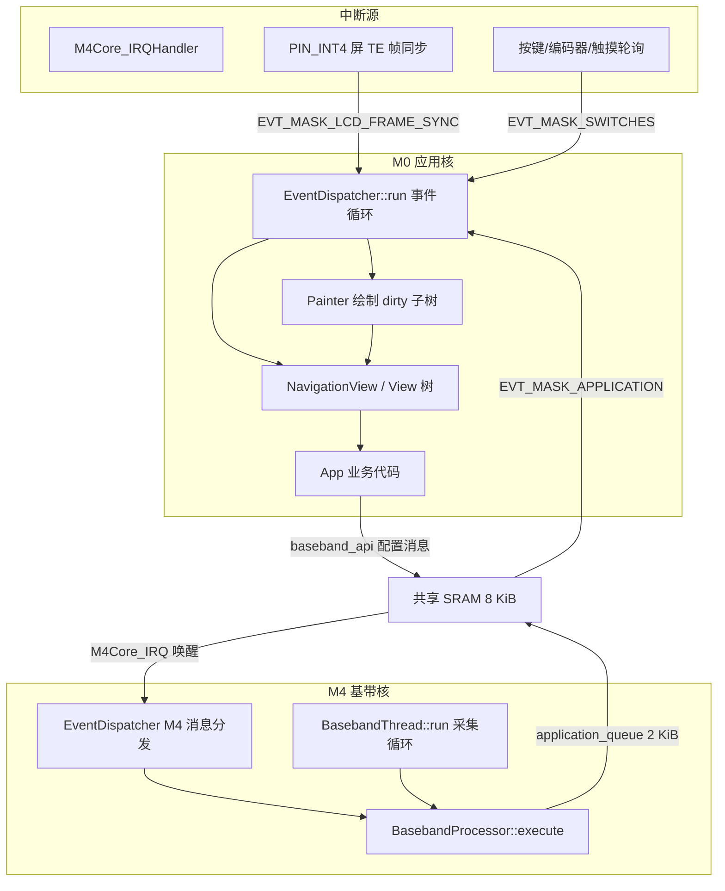
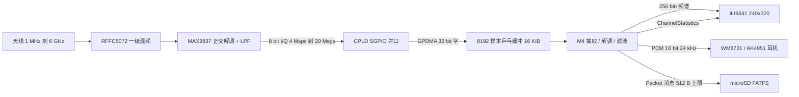

# PortaPack Mayhem 源码详解 00：总览与架构

> 涉及文件（仓库根 = `/Users/theo-richard/workspace/04-项目实战/mayhem-firmware`）：
> - `firmware/application/main.cpp`（235 行，M0 入口）
> - `firmware/application/portapack.cpp`（741 行，板级初始化 / 时钟 / 关机）
> - `firmware/application/event_m0.cpp`（662 行，M0 事件循环）
> - `firmware/application/ui_navigation.cpp`（1376 行，视图栈与系统外壳）
> - `firmware/baseband/baseband_thread.cpp`（137 行，M4 采集循环）
> - `firmware/baseband/baseband_dma.cpp`（189 行，GPDMA + SGPIO 乒乓缓冲）
> - `firmware/baseband/event_m4.cpp`（125 行，M4 消息分发）
> - `firmware/common/portapack_shared_memory.hpp`（100 行，双核共享区布局）
> - `firmware/common/memory_map.hpp`（160 行，SRAM/SPIFI 分区）
> - `firmware/application/baseband_api.cpp`（640 行，M0 → M4 控制面）
>
> 相关 KB：[event_dispatcher.md](../../../05-学习笔记与知识库/Knowledge-Base/mayhem/event_dispatcher.md)、[baseband_processor.md](../../../05-学习笔记与知识库/Knowledge-Base/mayhem/baseband_processor.md)

---

## 1. 这是什么固件：一台"掌上 SDR"

PortaPack 是 HackRF One 的扩展板，Mayhem 固件让这套组合脱离电脑独立工作：频谱分析、
AM/NFM/WFM 收音、ADS-B / AIS / APRS / POCSAG 解码、OOK/FSK/BLE 发射、GPS 模拟、
录音与基带抓取……代码量约 2700 个文件，但**架构骨架只有一条主线**：

> 一颗双核 MCU（LPC4320）里，**M0 核跑 UI 与应用，M4 核跑实时 DSP**，
> 两核通过一块 8 KiB 的共享 SRAM 里的两个环形消息队列 + 一个裸指针通信。

抓住这条主线，剩下的都是插件式应用与 DSP 算法。

## 2. 硬件全景

| 部件 | 型号 | 在固件里的位置 | 关键参数 |
|---|---|---|---|
| 主控 | NXP LPC4320 | `firmware/application/`（M0）、`firmware/baseband/`（M4） | Cortex-M4F 204 MHz + Cortex-M0 204 MHz；实际跑 200 MHz（`portapack.cpp:159-164`） |
| 一级混频 | RFFC5072 | `first_if`（`main.cpp:149`） | 覆盖 30 MHz–6 GHz 的本振，低/中/高频段拼 LO |
| 二级收发 | MAX2837（PRALINE 为 MAX2831） | `second_if`（`radio.cpp`） | 2.17–2.74 GHz 直接变频；LNA 0–40 dB/8 dB 步进、VGA 0–62 dB/2 dB、TX 0–47 dB/1 dB（`hw/max283x.hpp:46-68`） |
| 时钟 | Si5351 | `clock_manager.cpp` | 生成采样时钟与 40 MHz 参考；支持 ppm 校正 |
| 逻辑 | HackRF CPLD（XC2C64A）+ PortaPack CPLD/FPGA | `hackrf::cpld`、`baseband_cpld.cpp` | SGPIO 并口采样、LCD/按键/背光桥接 |
| 屏 | ILI9341 | `common/lcd_ili9341.cpp` | 240×320 RGB565；横屏时 320×240；TE 信号触发帧同步中断 |
| 触摸 | 电阻屏 + ADC | `application/touch.cpp`、`irq_controls.cpp` | 压力→X→Y 三相位轮询 |
| 音频 | WM8731 或 AK4951 | `common/wm8731.cpp`、`ak4951.cpp` | I2S 输出，采样率随基带配置（常见 24 kHz/48 kHz） |
| 存储 | microSD（SDIO） | `application/sd_card.cpp` | FATFS，块最大 512 B（`file.hpp:179`） |

### 2.1 固件能识别的板型（代码可见的差异）

| 板型 | 识别依据 | 关键差异 |
|---|---|---|
| HackRF One R2（20170522） | CPLD JTAG IDCODE / 持久化配置 | 背光用 CAT4004（可调），CPLD 位流 `rev_20170522` |
| HackRF One R1（20150901） | 同上 | 背光只能开关，CPLD 位流 `rev_20150901` |
| AGM 版 | IDCODE = `0x25610` | 单独分支，跳过按键选择 |
| PRALINE（LPC4330 + MAX2831 + FPGA） | 编译宏 `PRALINE` / `PORTAPACK_BOARD_PRALINE` | 4 MB Flash、64 KiB `m4_code`、FPGA 1/4 速率搬移、独立调谐表 |
| PortaRF（320×480 屏） | LCD ID = `5537894` | `screen_width/height` 改成 320×480，`DEV_PORTARF` 分支 |

识别逻辑在 `portapack.cpp:210-262`（`portapack_model()`）：先读 CPLD IDCODE，再读开机按键组合，
最后落到持久化配置；**按键组合只在当次开机生效并写回备份 SRAM**，所以"按 Up 开机"会永久改变
后续的背光/CPLD 选择，直到再按 Select 复位为自动检测。

`portapack::init()` 会做机型自检：JTAG 读 CPLD IDCODE 判断 AGM 版，否则按开机按键组合/持久化
配置在 R1/R2 之间选择（`portapack.cpp:210-262`），并据此选 CPLD 位流与背光驱动
（`backlight()`，`portapack.cpp:280-286`）。

## 3. 双核分工：谁跑什么、内存怎么分

| 维度 | M0 核（应用） | M4 核（基带） |
|---|---|---|
| 代码位置 | 内部 Flash / SPIFI 映射 | SPI Flash 里的 LZ4 压缩镜像，启动时解压到 SRAM |
| 代码区 | — | `m4_code`：LPC4320 上 40 KiB（`memory_map.hpp:106-111`） |
| 栈 | ChibiOS 主线程栈（链接脚本定义） | `baseband_thread_wa` = **4096 B**（`baseband_thread.cpp:42`） |
| 主循环 | `EventDispatcher::run()` 等事件 | `BasebandThread::run()` 等 DMA 缓冲 |
| 实时性 | 软实时（UI 60 Hz 刷屏） | 硬实时（缓冲周期 2.67 ms @3.072 Msps） |
| 可替换性 | 固定 | 每个应用带一个独立 `.img`，运行时换镜像 |

### 3.1 内存账本（LPC4320，非 PRALINE）

| 区域 | 地址 | 大小 | 用途 |
|---|---|---|---|
| `local_sram_0` | `0x1000_0000` | 96 KiB | M4 的 RAM（堆/栈/缓冲） |
| `local_sram_1` | `0x1008_0000` | 40 KiB | `m4_code`（解压后的基带镜像） |
| `shared_memory` | `0x1000_0000 + 96K − 8K` | 8 KiB | 两个消息队列 + 控制字段 |
| `ahb_ram_0/1/2` | `0x2000_0000` 起 | 32 + 16 + 16 KiB | 通用 AHB SRAM |
| `spifi_cached` | — | Flash 容量（1–4 MB） | 应用代码 + 压缩的基带镜像链 |

一个基带镜像必须 ≤ 40 KiB（`m4_code`），压缩后存放在 SPI Flash 的 chunk 链里。
这就是"为什么每个 App 的 DSP 都很克制"的根本原因：**放不下第二个镜像同时驻留**，
换 App 必须重新解压 + 复位 M4（约几十毫秒）。

共享区（`SharedMemory`，`portapack_shared_memory.hpp:57-96`）固定在两颗核相同的地址：

| 成员 | 大小 | 作用 |
|---|---|---|
| `application_queue_data` | `1 << 11` = 2048 B | M4 → M0：频谱、解调包、统计 |
| `app_local_queue_data` | 2048 B | M0 内部（ISR/其它线程 → 事件循环） |
| `baseband_message` | 4 B 指针 | M0 → M4 的控制消息（一次一条，发完自旋等清空） |
| `bb_data` | 512 B union | 音调表/干扰信道等大块参数 |
| `baseband_ready` / `radio_tx_drain` / 性能计数 | 若干字节 | 启动握手、TX 排空、调试 |

**为什么队列只有 2 KiB？** `Message::MAX_SIZE = 512`（`message.hpp:54`），一条最大消息占 512 B，
所以每个队列最多缓存 4 条满尺寸消息。这是刻意的背压设计：队列满时 `push()` 返回 false，
基带侧丢帧而不是阻塞。

## 4. 软件分层

| 层 | 目录 | 职责 | 典型文件 |
|---|---|---|---|
| 应用层 | `firmware/application/apps/`、`external/` | 每个功能一个 `View` 子类 | `analog_audio_app.cpp`、`capture_app.cpp` |
| 应用框架 | `firmware/application/` | 事件循环、导航、Radio 模型、文件/设置 | `event_m0.cpp`、`ui_navigation.cpp`、`receiver_model.cpp` |
| 公共库 | `firmware/common/` | UI 控件/绘制、DSP、编解码、协议、驱动封装 | `ui_widget.cpp`、`dsp_fft.cpp`、`lcd_ili9341.cpp` |
| 基带 | `firmware/baseband/` | 每镜像一个 `BasebandProcessor` 子类 + `main()` | `proc_nfm_audio.cpp`、`proc_wideband_spectrum.cpp` |
| 独立应用 | `firmware/standalone/` | 不依赖 Mayhem 外壳的极简程序 | 独立链接 |
| 第三方 | `firmware/chibios/`、`firmware/lib/`、`hackrf/` | RTOS、FatFs、LZ4、HackRF 平台代码 | 只读，不在本文范围 |

## 5. 一条完整的接收链（数据流）

以 NFM 收音为例，采样率 3.072 Msps：

1. 天线 → RFFC5072（需要时）→ MAX2837 正交下变频 → 8 bit I/Q；
2. CPLD 以 SGPIO 并口把 I/Q 打包成 32 bit 字，GPDMA 搬进 SRAM（每缓冲 8192 个 `complex8_t` = 16 KiB，
   拆成 2 个 4096 样本的 LLI）；
3. M4 的 `BasebandThread` 取到缓冲 → `NarrowbandFMAudio::execute()` 做 4 级抽取（÷4、÷2、÷8、通道 FIR）
   → FM 解调 → 音频 IIR（高通/去加重）→ I2S 输出；
4. 同时把 256 bin 的 `ChannelSpectrum` 和 `ChannelStatistics` 塞进 `application_queue`；
5. M0 事件循环收到 `EVT_MASK_APPLICATION`，按 `Message::ID` 分发给对应 App 的
   `MessageHandlerRegistration`，App 调 `set_dirty()`；
6. `EVT_MASK_LCD_FRAME_SYNC`（屏 TE 中断，约 60 Hz）到来时，`Painter::paint_widget_tree()`
   只重绘 dirty 子树，SPI 写 ILI9341 显存。

## 6. 架构图

**执行流（两颗核、两类中断、两个队列）**：

**数据流（天线 → 屏幕/耳机/存储）**：

## 7. 量化基线（后面每篇都会复用）

| 量 | 数值 | 推导 |
|---|---|---|
| 基带缓冲样本数 | 8192 | `buffer_samples_log2n = 13`（`baseband_dma.cpp:90-91`） |
| 基带缓冲字节 | 16 KiB | 8192 × `sizeof(complex8_t)` = 8192 × 2 |
| 单次 DMA 传输 | 4096 样本 / 8 KiB | `transfers_per_buffer = 2`（`:92-94`） |
| 缓冲周期 @3.072 Msps | 2.667 ms | 8192 / 3 072 000 |
| 缓冲周期 @20 Msps | 0.410 ms | 8192 / 20 000 000 |
| 消息队列容量 | 2048 B / 队列 | `1 << application_queue_k`，k = 11 |
| 单条消息上限 | 512 B | `Message::MAX_SIZE` |
| 基带线程栈 | 4096 B | `WORKING_AREA(baseband_thread_wa, 4096)` |
| 屏分辨率 | 240×320 = 76 800 px | `lcd_ili9341.cpp:391-392` |
| 整屏像素字节 | 150 KiB | 76 800 × 2 B（RGB565），远超任何 SRAM 缓冲，所以只能局部重绘 |
| 通道频谱 FFT | 256 点 | `SpectrumCollector::channel_spectrum`（`spectrum_collector.hpp`） |
| 系统 tick | 1 kHz | `CH_FREQUENCY 1000`（`application/chconf.h:44-45`） |

### 7.1 两个常用推导

- **一帧能画多少字**：屏 240×320，字符 8×16，扣除顶栏 16 px、底栏 16 px →
  (320−32)/16 = 18 行，(240)/8 = 30 列 → 540 字符/整屏。
- **M4 每个缓冲的预算**：`8192` 样本的缓冲被拆成 2 次 DMA，每次 4096 样本；
  3.072 MSa/s 时每 1.333 ms 一次 `execute()`，200 MHz 下约 26.7 万周期；
  20 MSa/s 时只有 4.1 万周期，这是高采样率抓取会丢样本的算术根源。

## 8. 读码路径建议

1. 先读本文，记住"两个队列 + 一个指针"。
2. 读 [01-启动流程与调度](01-启动流程与调度.md)：弄清 `main()` 到首个 `View` 的 8 个阶段。
3. 读 [02-应用框架与导航](02-应用框架与导航.md)：`Widget`/`View`/`NavigationView` 的所有权规则。
4. 读 [03-接收链路与基带](03-接收链路与基带.md) 与 [04-发射链路与应用](04-发射链路与应用.md)：
   数据从哪来、到哪去。
5. 想改界面看 [05-UI组件与渲染](05-UI组件与渲染.md)；想存文件看 [06-存储与文件格式](06-存储与文件格式.md)；
   想加 App 看 [07-开发与调试指南](07-开发与调试指南.md)。

## 9. 陷阱与实测建议

- **别把 M0 当实时核**：UI 事件循环里任何超过 ~16 ms 的阻塞都会掉帧；`baseband_api.cpp:47-73`
  的 `send_message()` 是**自旋等待** M4 取走消息，在 3 s 超时后 `chDbgPanic`。
  在 App 里连续发几十条配置消息会明显卡顿。
- **共享区布局不能随意改**：`SharedMemory` 的成员顺序/大小必须与 M4 二进制一致
  （`portapack_shared_memory.hpp:56` 的原注释明确要求）。改这个结构 = 两核 ABI 变更。
- **M4 镜像是按需加载的**：`baseband::run_image()` 触发 `m4_init()` 解压 LZ4 到 `m4_code` 并复位 M4，
  再从 SPI Flash chunk 链里按 4 字符 tag 查找（`core_control.cpp:49-72`）。App 构造函数里调用它很常见，
  但**不能重复调用**（已在跑时 `chDbgPanic("BBRunning")`）。
- **PRALINE 与 HackRF One 差异很大**：`#ifdef PRALINE` 分支覆盖调谐表、FPGA 1/4 速率搬移、
  AFE 策略等。读代码时先确认自己关心的板型，否则会把两套逻辑混在一起。
- **量化优先**：遇到"为什么卡"，先算缓冲周期（8192/fs）和消息速率，再看队列是否溢出
  （`shared_memory.m4_buffer_missed` 可直接读出丢缓冲计数）。
