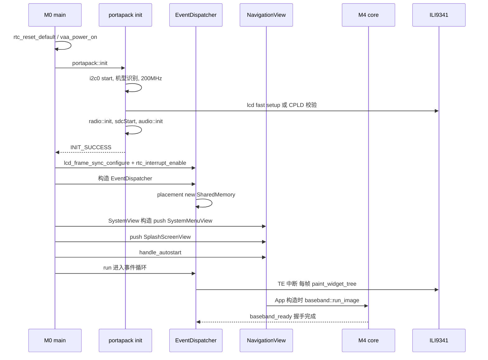
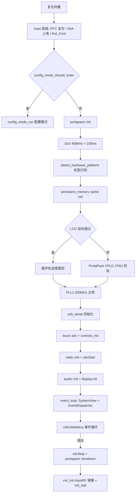
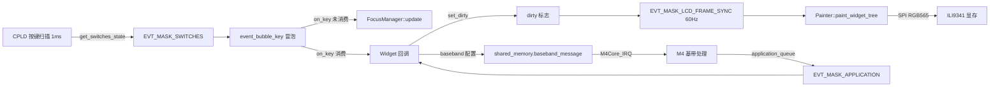

# PortaPack Mayhem 源码详解 01：启动流程与调度

> 涉及文件：
> - `firmware/application/main.cpp`（235 行，复位后第一段 C++ 代码）
> - `firmware/application/portapack.cpp`（741 行，板级初始化 `init()`）
> - `firmware/application/event_m0.cpp`（662 行，事件循环 `EventDispatcher`）
> - `firmware/application/ui_navigation.cpp`（1376 行，`SystemView` 装配）
> - `firmware/application/irq_rtc.cpp`（140 行，1 Hz tick）
> - `firmware/application/irq_lcd_frame.cpp`（72 行，屏 TE 帧同步中断）
> - `firmware/application/irq_controls.cpp`（322 行，按键/编码器/触摸扫描）
> - `firmware/application/core_control.cpp`（94 行，M4 镜像加载）
>
> 相关 KB：[event_dispatcher.md](../../../05-学习笔记与知识库/Knowledge-Base/mayhem/event_dispatcher.md)、[navigation.md](../../../05-学习笔记与知识库/Knowledge-Base/mayhem/navigation.md)

---

## 1. 启动的 8 个阶段（全景表）

| # | 阶段 | 代码位置 | 做了什么 | 失败/分支 |
|---|---|---|---|---|
| 0 | 芯片复位 → ChibiOS `__early_init` | `firmware/chibios-portapack/`（第三方） | 关看门狗、初始化时钟、堆栈 | — |
| 1 | `main()` 前段 | `main.cpp:188-199` | 复位 RTC、开 VAA 电源、`first_if.init()` 避免天线偏置毛刺、检测配置模式 | 长按特定键进 `config_mode_run()` |
| 2 | `portapack::init()` | `main.cpp:203`、`portapack.cpp:563-712` | I2C、机型识别、CPLD 校验、200 MHz 主频、USB、触摸、Radio、SD、音频、LCD | 返回 4 种状态码，见下文 |
| 3 | 外设中断使能 | `main.cpp:212-213` | `lcd_frame_sync_configure()` 开 TE 中断；`rtc_interrupt_enable()` 开 1 Hz | — |
| 4 | 主题加载 | `main.cpp:215` | 从持久化内存读主题 ID | — |
| 5 | `event_loop()` | `main.cpp:167-185` | 构造 `Context`/`SystemView`/`EventDispatcher`，注册消息，跑 `handle_autostart()` | 开机自启 App |
| 6 | 进入事件循环 | `event_m0.cpp:126-131` | `chEvtWaitAny(ALL_EVENTS)` 阻塞，事件到来才醒 | `request_stop()` 退出 |
| 7 | 退出清理 | `main.cpp:219-223` | 卸载 SD、`portapack::shutdown()` | — |
| 8 | 交棒给 HackRF 模式 | `main.cpp:231-232` | 加载 `image_tag_hackrf` 到 M4、`m0_halt()` | 只在下电/切模式时走 |

## 2. `main()` 逐段精读

`main.cpp:167-185`：

```cpp
static void event_loop() {
    static ui::Context context;
    static ui::SystemView system_view{
        context,
        portapack::display.screen_rect()};

    system_view_ptr = &system_view;

    EventDispatcher event_dispatcher{&system_view, context};
    static MessageHandlerRegistration message_handler_display_sleep{
        Message::ID::DisplaySleep,
        [&event_dispatcher](const Message* const) {
            event_dispatcher.set_display_sleep(true);
        }};
    portapack::setEventDispatcherToUSBSerial(&event_dispatcher);
    i2cdev::I2CDevManager::setEventDispatcher(&event_dispatcher);
    system_view.get_navigation_view()->handle_autostart();
    event_dispatcher.run();
}
```

逐行要点：

- `static ui::Context` / `static ui::SystemView`：两者都放在 **静态存储区**，不占主线程栈。
  `SystemView` 内部内嵌 `NavigationView`、`SystemStatusView`、`InformationView`、`NotificationView` 四个视图
  （`ui_navigation.hpp:489-495`），是一个几十 KB 的对象，绝不能放栈上。
- `system_view_ptr` 是全局裸指针（`main.cpp:150`），供 USB 串口 shell 等无处拿 `nav` 的模块访问。
- `EventDispatcher` 构造时 `init_message_queues()` 用 **placement new** 在固定地址重建
  `SharedMemory`（`event_m0.cpp:649-651`），原因见第 6 节。
- `MessageHandlerRegistration` 是 RAII：构造时向全局 `message_map` 注册，析构时注销
  （`event_m0.cpp:653-662`）。同一 `Message::ID` 注册两次会 `chDbgPanic("MsgDblReg")`
  （`event_m0.cpp:82-84`）。
- `handle_autostart()` 在进入循环前调用：读 `SETTINGS/nav.ini` 的 `autostart_app`，
  先按内部 App id 找，再试 `.ppma`/`.ppmp`（`ui_navigation.cpp:844-886`）。

`main.cpp:203-229` 的状态机：

```cpp
    switch (portapack::init()) {
        case portapack::init_status_t::INIT_HACKRF_CPLD_FAILED:
            portapack::init_error = "HACKRF CPLD FAILED";
            [[fallthrough]];

        case portapack::init_status_t::INIT_SUCCESS:

            config_mode_clear();

            lcd_frame_sync_configure();
            rtc_interrupt_enable();

            Theme::SetTheme((Theme::ThemeId)portapack::persistent_memory::ui_theme_id());

            event_loop();

            sdcDisconnect(&SDCD1);
            sdcStop(&SDCD1);

            portapack::shutdown();
            break;

        case portapack::init_status_t::INIT_NO_PORTAPACK:
        case portapack::init_status_t::INIT_PORTAPACK_CPLD_FAILED:
            config_mode_clear();
            break;
    }
```

设计意图：**CPLD 失败仍然进 UI**（只置 `init_error`），让用户在屏幕上看到" guru meditation"
而不是黑屏；而"没有 PortaPack 板"或"PortaPack CPLD 失败"则直接跳出，落到第 8 阶段去跑 HackRF 固件。

## 3. `portapack::init()`：板级初始化的 14 个动作

`portapack.cpp:563-712` 的顺序不能随意调换，关键依赖如下：

| 顺序 | 动作 | 行号 | 依赖/原因 |
|---|---|---|---|
| 1 | `set_idivc_base_clocks(IDIVC)` | 564 | 先让 M4/外设时钟切到 IDIVC，I2C 才有正确时钟 |
| 2 | `i2c0.start(i2c_config_boot_clock)` + 100 ms | 566-568 | 400 kHz I2C，给 CPLD/音频芯片上电稳定 |
| 3 | `detect_hardware_platform()` | 570 | 识别 HackRF One / PRALINE / PortaRF |
| 4 | `configure_pins_portapack()` + `io.init()` | 575-577 | GPIO/CPLD 引脚复用 |
| 5 | `persistent_memory::cache::init()` | 578 | 读备份 SRAM 里的设置（含 CPLD 版本、主题） |
| 6 | LCD 快速自检 `read_display_status()` | 581-588 | 成功则先画开机图，失败才走 CPLD JTAG 校验 |
| 7 | `power_control::core_power_on()` + `clock_manager.init_clock_generator()` | 595-597 | 给 M4 内核与 Si5351 上电 |
| 8 | 切 IRC → 禁 PLL1 → `set_cpu_clock_speed()` | 601-606 | 先降频再改 PLL，避免超频窗口 |
| 9 | `usb_serial.initialize()` | 618 | USB CDC 枚举，之后可被 shell 使用 |
| 10 | 音频芯片探测 `is_portapack_present()` | 624-625 | 用 WM8731/AK4951 的 I2C 应答判断板子是否插着 |
| 11 | `touch::adc::init()` + `controls_init()` | 630-631 | 触摸 ADC 与按键扫描 |
| 12 | `clock_manager.enable_if_clocks()` / `enable_codec_clocks()` | 636-637 | 参考时钟 ppm 校正后再开 IF/音频时钟 |
| 13 | `radio::init()` + `sdcStart()` + `sd_card::poll_inserted()` | 667-670 | Radio 初始化会用到已稳定的时钟 |
| 14 | HackRF CPLD 加载、GPDMA 使能、`audio::init()`、`display.init()` | 681-707 | GPDMA 必须在音频 I2S 之前；LCD 最后初始化以便显示错误 |

两个容易忽略的细节：

- 第 6 步的"快速自检"路径会跳过 PortaPack CPLD 校验，它是给 **LCD 排线正常但 CPLD 未编程** 的
  机器留的救砖通道——`lcd_fast_setup` 为真时整段启动都会在屏幕上打 5 个进度图标
  （`bitmap_icon_memory/remote/sd/hackrf/speaker`）。
- 第 8 步的时钟表是分级的：`clock_config_irc`（12 MHz）→ `clock_config_pll1_boot`（96 MHz）
  → `clock_config_pll1_step`（100 MHz）→ `clock_config_pll1`（200 MHz）
  （`portapack.cpp:138-164`）。**200 MHz 是 LPC4320 的标称上限**，再高会不稳。

## 4. `EventDispatcher`：M0 的唯一调度器

### 4.1 事件位定义

`event_m0.hpp:41-48`：

```cpp
constexpr auto EVT_MASK_RTC_TICK = EVENT_MASK(0);
constexpr auto EVT_MASK_LCD_FRAME_SYNC = EVENT_MASK(1);
constexpr auto EVT_MASK_SWITCHES = EVENT_MASK(3);
constexpr auto EVT_MASK_ENCODER = EVENT_MASK(4);
constexpr auto EVT_MASK_TOUCH = EVENT_MASK(5);
constexpr auto EVT_MASK_APPLICATION = EVENT_MASK(6);
constexpr auto EVT_MASK_LOCAL = EVENT_MASK(7);
constexpr auto EVT_MASK_USB = EVENT_MASK(8);
```

| 事件位 | 触发源 | 频率 | 处理函数 |
|---|---|---|---|
| bit0 RTC_TICK | RTC 秒中断 | 1 Hz | `handle_rtc_tick()`：SD 插拔轮询、背光超时、`rtc_time::on_tick_second()`、持久化 cache 落盘 |
| bit1 LCD_FRAME_SYNC | 屏 TE 上升沿（PIN_INT4） | 约 60 Hz | `handle_lcd_frame_sync()`：`paint_widget_tree()` |
| bit3 SWITCHES | CPLD 按键扫描（`switch_update`） | 每 1 ms 轮询 | `handle_switches()` |
| bit4 ENCODER | 编码器正交解码 | 转动时 | `handle_encoder()` |
| bit5 TOUCH | 触摸三相位采样完成 | 采样率相关 | `handle_touch()` → `touch::Manager::feed()` |
| bit6 APPLICATION | M4 `creg::m4txevent` → `M4Core_IRQHandler` | 随基带消息 | `handle_application_queue()` |
| bit7 LOCAL | M0 内部 `send_message()` | 按需 | `handle_local_queue()` |
| bit8 USB | USB 传输完成中断 | 随 USB | `handle_usb()` / `handle_usb_transfer()` |

### 4.2 等待与分发

`event_m0.cpp:330-332`：

```cpp
eventmask_t EventDispatcher::wait() {
    return chEvtWaitAny(ALL_EVENTS);
}
```

`event_m0.cpp:334-386` 的 `dispatch()` 顺序**是有意的**：

```cpp
void EventDispatcher::dispatch(const eventmask_t events) {
    if (shared_memory.m4_panic_msg[0] != 0) {
        if (shared_memory.bb_data.data[0] == 0)
            draw_guru_meditation(CORTEX_M4, shared_memory.m4_panic_msg);
        else
            draw_guru_meditation(
                CORTEX_M4,
                shared_memory.m4_panic_msg,
                (struct extctx*)&shared_memory.bb_data.data[8],
                *(uint32_t*)&shared_memory.bb_data.data[4]);
    }

    handle_shell();

    if (events & EVT_MASK_APPLICATION) {
        handle_application_queue();
    }

    if (events & EVT_MASK_LOCAL) {
        handle_local_queue();
    }
```

（其后依次是 `EVT_MASK_RTC_TICK`、USB、`EVT_MASK_SWITCHES`、`EVT_MASK_LCD_FRAME_SYNC`，
最后才是被 `display_sleep` 包起来的编码器/触摸分支，见 `event_m0.cpp:356-385`。）

1. **先查 M4 panic**：M4 崩溃时把字符串写进共享区，M0 每轮都查，优先显示" guru meditation"，
   避免后续绘制把错误信息盖掉。
2. **`handle_shell()` 最前**：USB shell 需要独占 UI（`shellmode_active` 自旋），必须在其它事件前让路。
3. **消息队列先于输入**：先消费 M4 数据，再处理按键，保证"按键时机"对齐的是最新数据。
4. **`EVT_MASK_APPLICATION` 与 `EVT_MASK_LOCAL` 分开**：前者来自 M4（外部），后者来自 M0 自己
   （如 `TransmitterModel::enable()` 里的 `TXDisabledMessage`）。两者最终都走同一个
   `message_map.send()`。
5. **帧同步最后**：`handle_lcd_frame_sync()` 会重绘整棵 dirty 树，放在最后可以把本轮所有状态变化
   一次性画出来，减少撕裂。

### 4.3 消息注册表

`event_m0.cpp:77-104` 用一个 `std::array<std::function<...>, MAX>` 按 `Message::ID` 下标直接索引：

```cpp
    void register_handler(const Message::ID id, MessageHandler&& handler) {
        if (map_[toUType(id)] != nullptr) {
            chDbgPanic("MsgDblReg");
        }
        map_[toUType(id)] = std::move(handler);
    }
```

复杂度 O(1)，代价是 `ID::MAX`（当前 124）个 `std::function` 的静态数组——每个 16 B 左右，
约 2 KB BSS。**ID 必须连续**，所以 `message.hpp:57` 的注释写着 "Assign consecutive IDs"。

> 注意：`Message::ID` 里有一个真实的重号——`FSKRxConfigure = 58` 与 `BlePacket = 58`
> （`message.hpp:116-117`）。由于注册表按 ID 索引，这两个消息会互相覆盖处理器。
> 这是**已知缺陷**，只记录不改（L 层红线）。

## 5. 首个 View 是怎么出现的

`SystemView` 构造函数（`ui_navigation.cpp:1068-1121`）是"界面骨架"的装配现场：

```cpp
SystemView::SystemView(
    Context& context,
    const Rect parent_rect)
    : View{parent_rect},
      context_(context) {
    set_style(Theme::getInstance()->bg_darkest);

    constexpr Dim status_view_height = 16;
    constexpr Dim info_view_height = 16;

    add_child(&status_view);
    status_view.set_parent_rect(
        {{0, 0},
         {parent_rect.width(), status_view_height}});
    status_view.on_back = [this]() {
        this->navigation_view.pop();
    };

    add_child(&navigation_view);
    navigation_view.set_parent_rect(
        {{0, status_view_height},
         {parent_rect.width(), static_cast<Dim>(parent_rect.height() - status_view_height)}});
```

关键点：

- **屏幕被切成三段**：顶部 16 px 状态栏、中间 `height-16` 的导航区、底部 16 px 信息栏
  （信息栏只在"顶级菜单"时显示，二级页面会被 `remove_child`，见 `:1096-1109`）。
- `navigation_view.push<SystemMenuView>()`（`:1111`）压入根菜单——这是**视图栈的第 1 层**，
  `pop()` 永远弹不掉它（`ui_navigation.cpp:761-762`）。
- 若 `pmem::config_splash()` 为真，再压入 `SplashScreenView`（`:1115-1117`），
  开机图显示约数秒后自己 `pop()`。
- `status_view.set_back_enabled(false)`：根页面没有返回键。

于是"首个 View"其实是 `SplashScreenView`（可选）→ `SystemMenuView`。`handle_autostart()` 若配置了
自启 App，会在事件循环开始前再压一层，直接进应用。

## 6. 为什么用 placement new 重建共享内存

`event_m0.cpp:649-651`：

```cpp
void EventDispatcher::init_message_queues() {
    new (&shared_memory) SharedMemory;
}
```

`shared_memory` 是链接脚本固定在 SRAM 顶部的 8 KiB 区（`memory_map.hpp:106-111`），
C++ 全局构造在这里**不可靠**（两核各自编译、构造顺序不确定）。所以在 M0 侧第一次创建
`EventDispatcher` 时，用 placement new 显式调用 `SharedMemory` 的默认构造，把两个
`MessageQueue`（含互斥量 `chMtxInit`）初始化到确定状态；M4 侧则依赖同一块内存的**二进制布局**
（`portapack_shared_memory.hpp:56` 的注释：结构体在两颗核里必须位于相同地址）。

## 7. 调度模型与线程表

| 线程 | 优先级（ChibiOS 数值） | 栈 | 说明 |
|---|---|---|---|
| M0 主线程（事件循环） | `NORMALPRIO` = 64 | 链接脚本定义 | 唯一跑 UI 的线程，`CH_TIME_QUANTUM = 0`（同优先级不抢占） |
| USB 串口线程 | `NORMALPRIO + 10` = 74 | 1024 B（`usb_serial_thread.cpp:36`） | 处理 shell 命令，会通过 `enter_shell_working_mode()` 抢 UI |
| M4 基带线程 | `NORMALPRIO + 20` = 84 | 4096 B（`baseband_thread.cpp:42`） | 只在 M4 上存在，与 M0 线程互不相干 |
| M4 RSSI 线程 | `NORMALPRIO + 10` = 74 | 默认 | 400 kHz 采样 RSSI，供场强显示 |
| I2C 设备管理器 | 未显式指定（默认） | — | 扫描 I2C 设备，3 s 周期（`ui_navigation.cpp:1102`） |

注意 `NORMALPRIO` 在本仓库的 ChibiOS 里是 **64**（`chibios/os/kernel/include/chschd.h:57`），
不是常见的 128。写优先级时别照搬别的工程经验。

## 8. 启动时序图



## 9. 启动流程的任务/执行流图



## 10. 数据流图：从一次按键到一帧画面



## 11. 陷阱与实测建议

- **不要在 `main()` 之前依赖全局构造**：两核各自链接，`SharedMemory` 必须 placement new；
  其它跨核结构同理。见 `event_m0.cpp:649-651`。
- **`EventDispatcher::dispatch()` 里任何一个 handler 卡住，整机"死机"**：因为只有这一个线程。
  实测中 `baseband::send_message()` 的自旋等待（最长 3 s）是最常见卡顿源。
- **显示睡眠（stealth 模式）会吞掉按键/编码器事件**：`dispatch()` 里
  `if (!EventDispatcher::display_sleep)` 才处理 `EVT_MASK_ENCODER/TOUCH`
  （`event_m0.cpp:377-385`）；按键则在 `handle_switches()` 里先用来"唤醒"（`:582-588`）。
- **1 Hz tick 做的事比看上去多**：SD 热插拔、背光计时、RTC 秒回调、持久化 cache 落盘全在里面
  （`event_m0.cpp:406-420`）。把耗时操作加进 `on_tick_second` 会每小时丢几十毫秒。
- **启动时间估算**：`portapack::init()` 里有多处 `chThdSleepMilliseconds(100/10/20)`，
  加上 CPLD JTAG 与音频芯片探测，冷启动到首帧按代码累加约 1.0–1.5 s（未实测，随板型/SD 卡变化）；
  若 LCD 自检失败改走 CPLD 校验路径，会再多 ~300 ms。
- **`config_mode` 是救砖入口**：开机时按住特定键组合会跳过整个固件进 `config_mode_run()`
  （`main.cpp:196-199`），它负责刷写/恢复。改启动流程时务必保留这一段。
