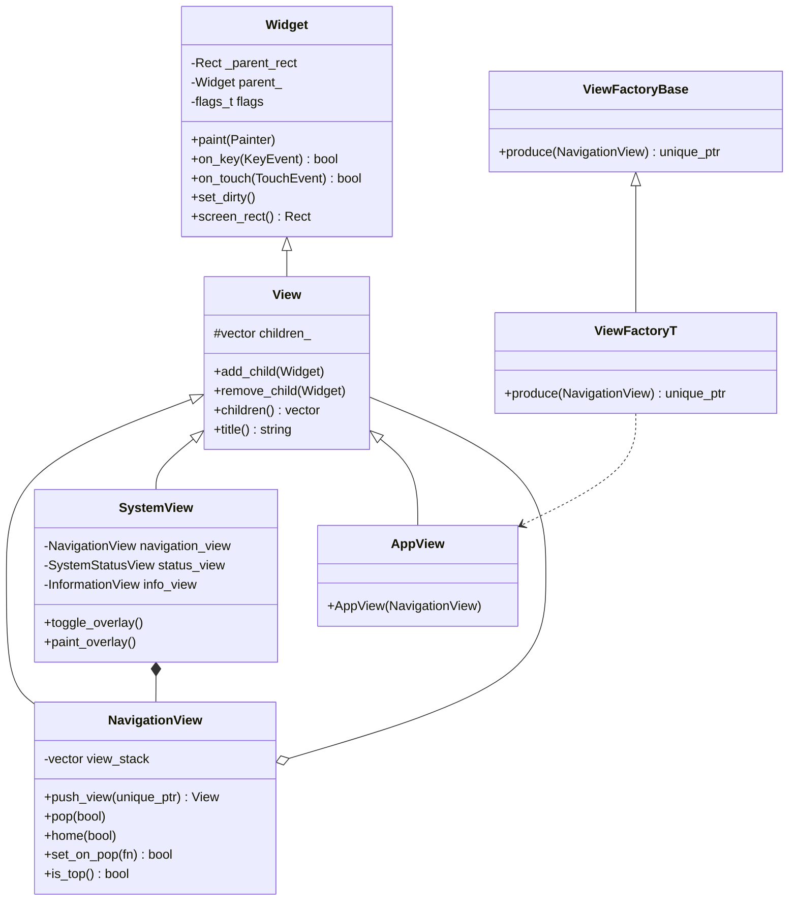
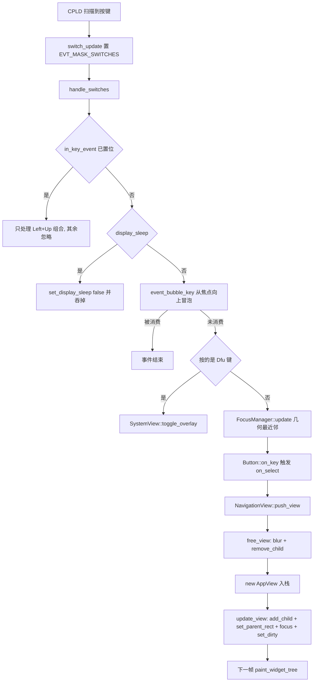
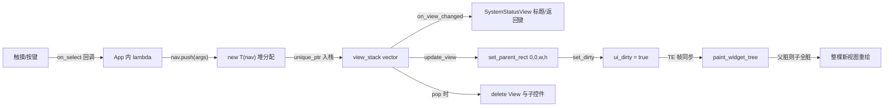

# PortaPack Mayhem 源码详解 02：应用框架与导航

> 涉及文件：
> - `firmware/common/ui_widget.hpp`（1177 行，`Widget`/`View` 与 28 个控件声明）
> - `firmware/common/ui_widget.cpp`（3399 行，控件实现与 dirty 传播）
> - `firmware/common/ui_focus.cpp`（222 行，方向键焦点导航）
> - `firmware/application/ui_navigation.hpp`（556 行，`NavigationView`/`SystemView`/`AppInfo`）
> - `firmware/application/ui_navigation.cpp`（1376 行，视图栈、appList、状态栏）
> - `firmware/application/view_factory.hpp`（约 45 行，`ViewFactory<T>`）
> - `firmware/application/event_m0.cpp`（662 行，事件冒泡与触摸命中）
>
> 相关 KB：[app_view.md](../../../05-学习笔记与知识库/Knowledge-Base/mayhem/app_view.md)、[navigation.md](../../../05-学习笔记与知识库/Knowledge-Base/mayhem/navigation.md)

---

## 1. 框架总览：三层对象 + 一条事件链

| 层次 | 类型 | 数量级 | 生命周期 |
|---|---|---|---|
| 控件 | `Widget` 子类（`Text`、`Button`、`OptionsField`…） | 每个 View 内 5–40 个 | 跟随父 View 的成员，栈式分配 |
| 页面 | `View` 子类（`NavigationView`、`SystemMenuView`、各 App） | 栈里 1–4 层 | `push` 时 `new`，`pop` 时 `delete` |
| 外壳 | `SystemView` | 1 个 | `main.cpp` 里的 `static` 对象，永不销毁 |

事件链只有一条：**中断/消息 → `EventDispatcher` → 焦点控件 → 冒泡到父控件**。
没有信号槽、没有观察者总线（`Signal<>` 只用于少数模型层，如 `sd_card::status_signal`）。

## 2. `Widget`：一切控件的基类

`ui_widget.hpp:62-161` 的成员布局决定了所有控件的内存开销：

```cpp
class Widget {
   public:
    ...
    Point screen_pos();
    Size size() const;
    Rect screen_rect() const;
    Rect parent_rect() const;
    virtual void set_parent_rect(const Rect new_parent_rect);
    ...
   protected:
    void dirty_overlapping_children_in_rect(const Rect& child_rect);

   private:
    /* Widget rectangle relative to parent pos(). */
    Rect _parent_rect;
    const Style* style_{nullptr};
    Widget* parent_{nullptr};

    struct flags_t {
        bool dirty : 1;        // Widget content has changed.
        bool hidden : 1;       // Hide widget and children.
        bool focusable : 1;    // Widget can receive focus.
        bool highlighted : 1;  // Show in a highlighted style.
        bool drawn : 1;        // Object was drawn during last paint.
    };

    flags_t flags{
        .dirty = true,
        .hidden = false,
        .focusable = false,
        .highlighted = false,
        .drawn = false,
    };

    static const std::vector<Widget*> no_children;
};
```

| 字段 | 类型/位宽 | 含义 | 行号 |
|---|---|---|---|
| `_parent_rect` | `Rect`（4 × int16 = 8 B） | 相对父控件左上角的矩形 | 140 |
| `style_` | 指针 4 B | 指向主题里的 `Style`（字体+前景+背景） | 141 |
| `parent_` | 指针 4 B | 父控件；`nullptr` = 未挂载 | 142 |
| `flags` | 5 bit（编译器实际占 1 B） | dirty/hidden/focusable/highlighted/drawn | 144-150 |
| `id` | int16 | 焦点导航里的特殊标记，`-1` = 返回键 | 122 |

每个 `Widget` 头开销约 **24 B**（vptr 4 + 三个成员 12 + flags/id 对齐 4+2→4）。
100 个控件的界面约 2.4 KB，加上 `View::children_` 的 `std::vector`（每个 View 一次堆分配）。

### 2.1 坐标是"相对父控件"的

`ui_widget.cpp:71-75`：

```cpp
Rect Widget::screen_rect() const {
    return parent() ? (parent_rect() + parent()->screen_pos()) : parent_rect();
}
```

`screen_pos()` 就是 `screen_rect().location()`，于是一次 `screen_rect()` 会**沿父链递归到根**。
深度为 d 的控件，`screen_rect()` 是 O(d)。这就是为什么 `Painter` 只在必要时调用它，
而 `dirty_overlapping_children_in_rect()` 里也只对直接子节点做一次相交判断。

另外 `View` 的坐标系有一个约定（`ui_widget.hpp:164-166` 的注释）：

> unlike Paint class, our Y ignored the top bar; so when you draw some of us as Y = 0,
> it would be exact below the top bar, instead of overlapped with top bar

即 App 里的 `y = 0` 指的是**状态栏下方**，不是物理屏顶。`SystemView` 通过给
`navigation_view` 设置 `{0, 16}` 的父矩形实现这一点（`ui_navigation.cpp:1087-1089`）。

### 2.2 dirty 是一棵"向下的瀑布"

`ui_widget.cpp:110-118`：

```cpp
void Widget::set_dirty() {
    flags.dirty = true;
    dirty_set();
}

bool Widget::dirty() const {
    return flags.dirty;
}
```

`dirty_set()` 只是把文件级静态 `ui_dirty` 置真（`ui_widget.cpp:47-49`）。
真正的绘制决策在 `Painter::paint_widget()`（`ui_painter.cpp:122-145`）：

```cpp
void Painter::paint_widget(Widget* w) {
    if (w->hidden()) {
        // Mark widget (and all children) as not drawn.
        w->drawn(false);
    } else {
        // Mark this widget as drawn and recurse.
        w->drawn(true);

        if (w->dirty()) {
            w->paint(*this);
            // Force-paint all children.
            for (const auto child : w->children()) {
                child->set_dirty();
                paint_widget(child);
            }
            w->set_clean();
        } else {
            // Selectively paint all children.
            for (const auto child : w->children()) {
                paint_widget(child);
            }
        }
    }
}
```

规则只有两条：

1. **父脏则子全脏**：父控件重绘会覆盖子控件区域，所以必须强制子控件也重绘。这是"没有裁剪区"
   的代价，也是最容易掉帧的地方——一个全屏 `Rectangle` 变脏会导致整棵树重绘。
2. **父不脏则只递归**：子控件各自判断自己的 dirty。

`drawn` 标志供触摸/绘制逻辑查询"上一次是否真的画出来了"（隐藏的控件传播 `drawn(false)`）。

## 3. `View`：容器与生命周期

`ui_widget.hpp:163-190`：

```cpp
class View : public Widget {
    // unlike Paint class, our Y ignored the top bar;
    // so when you draw some of us as Y = 0, it would be exact below the top bar, instead of overlapped with top bar
   public:
    View() {
    }

    View(Rect parent_rect) {
        set_parent_rect(parent_rect);
    }

    // TODO: ~View() should on_hide() all children?

    void paint(Painter& painter) override;

    void add_child(Widget* const widget);
    void add_children(const std::initializer_list<Widget*> children);
    void remove_child(Widget* const widget);
    void remove_children(const std::vector<Widget*>& children);
    const std::vector<Widget*>& children() const override;

    virtual std::string title() const;

   protected:
    std::vector<Widget*> children_{};

    void invalidate_child(Widget* const widget);
};
```

- `children_` 存**裸指针**，所有权在 App 类成员（通常是值成员）。`View` 析构**不会** delete 子控件，
  这是刻意的：绝大多数控件的生命周期 = 宿主 View 的生命周期，值成员自动析构即可。
- `add_child()` 会跳过已挂载的控件（`widget->parent() == nullptr` 才加，`ui_widget.cpp:269-276`），
  所以"把同一个控件加到两个 View"是静默失败。
- `remove_child()` 会 `set_parent(nullptr)`，触发 `on_before_detach()` 并把 `drawn` 置假
  （`ui_widget.cpp:284-289`、`ui_widget.hpp:89-90`）。

## 4. `NavigationView`：视图栈

### 4.1 数据结构

`ui_navigation.hpp:163-183`：

```cpp
   private:
    struct ViewState {
        std::unique_ptr<View> view;
        std::function<void()> on_pop;
    };
    ...
    std::vector<ViewState> view_stack{};
```

`unique_ptr` 说明**栈持有所有权**，`pop` 即销毁；`on_pop` 是一个"销毁后回调"，
用于在页面关闭后做收尾（例如停止录制、刷新列表）。

### 4.2 压栈/出栈

`ui_navigation.cpp:750-757`：

```cpp
View* NavigationView::push_view(std::unique_ptr<View> new_view) {
    free_view();
    const auto p = new_view.get();
    view_stack.emplace_back(ViewState{std::move(new_view), {}});

    update_view();
    return p;
}
```

`ui_navigation.cpp:759-774`：

```cpp
void NavigationView::pop(bool trigger_update) {
    // Don't pop off the NavView.
    if (view_stack.size() <= 1)
        return;

    auto on_pop = view_stack.back().on_pop;

    free_view();
    view_stack.pop_back();

    // NB: These are executed _after_ the view has been
    // destroyed. The old view MUST NOT be referenced in
    // these callbacks or it will cause crashes.
    if (trigger_update) update_view();
    if (on_pop) on_pop();
}
```

三个关键设计：

| 设计 | 原因 | 后果 |
|---|---|---|
| `size() <= 1` 不许 pop | 栈底是 `SystemMenuView`（`SystemView` 构造时压入） | 主页永远有"底色" |
| 先 `free_view()` 再 `pop_back()` | `free_view()` 要 `remove_child(view())`，必须先拿到旧指针 | 顺序反了会访问已释放对象 |
| `on_pop` 在销毁后执行 | 避免回调里再引用旧 View | 回调里只能操作"外部"状态（模型、文件、导航） |

`free_view()` 的实现解释了为什么必须先 `blur()`（`ui_navigation.cpp:799-807`）：

```cpp
void NavigationView::free_view() {
    // The focus_manager holds a raw pointer to the currently focused Widget.
    // It then tries to call blur() on that instance when the focus is changed.
    // This causes crashes if focused_widget has been deleted (as is the case
    // when a view is popped). Calling blur() here resets the focus_manager's
    // focus_widget pointer so focus can be called safely.
    this->blur();
    remove_child(view());
}
```

`FocusManager` 里 `focus_widget_` 是裸指针（`ui_focus.hpp`），没有生命周期跟踪。
`blur()` 把 `focus_widget_` 置空，才敢 delete 整棵子树。

### 4.3 视图切换后的重排

`ui_navigation.cpp:809-821`：

```cpp
void NavigationView::update_view() {
    const auto& top = view_stack.back();
    auto top_view = top.view.get();

    add_child(top_view);
    auto newSize = (is_top()) ? Size{size().width(), size().height() - 16} : size();  // if top(), then there is the info bar at the bottom, so leave space for it
    top_view->set_parent_rect({{0, 0}, newSize});
    focus();
    set_dirty();

    if (on_view_changed)
        on_view_changed(*top_view);
}
```

`is_top()` 的定义是 `view_stack.size() == 1`（`:742-744`）——注意它判断的是"**只有一层**"，
不是"最上层"。所以"顶级菜单"特指主页，此时底部留 16 px 给 `InformationView`；
进入任何子页面后，信息栏被移除、视图占满全屏。

## 5. App 注册表：`appList`

`ui_navigation.cpp:100-151` 是一张**编译期常量表**：

```cpp
const NavigationView::AppList NavigationView::appList = {
    /* HOME ******************************************************************/
    {nullptr, "Receive", HOME, Color::cyan(), &bitmap_icon_receivers, new ViewFactory<ReceiversMenuView>()},
    {nullptr, "Transmit", HOME, Color::cyan(), &bitmap_icon_transmit, new ViewFactory<TransmittersMenuView>()},
    ...
    {"audio", "Audio", RX, Color::green(), &bitmap_icon_speaker, new ViewFactory<AnalogAudioView>()},
```

`AppInfo` 的字段（`ui_navigation.hpp:73-81`）：

| 字段 | 含义 | 备注 |
|---|---|---|
| `id` | 唯一短名，串口命令/自启用 | `nullptr` 表示纯菜单项，不可按名启动 |
| `displayName` | 按钮文字 | 最多约 10 字符（按钮宽度限制） |
| `menuLocation` | `HOME/RX/TX/TRX/UTILITIES` | 决定出现在哪个网格 |
| `iconColor` | 图标着色 | 与 `icon` 位图叠加 |
| `icon` | 32×32 单色位图 | `bitmap_icon_*` |
| `viewFactory` | `ViewFactoryBase*` | **永不释放**（注释明确说明） |

`ViewFactory<T>` 只有一行（`view_factory.hpp:30-36`）：

```cpp
template <typename T>
class ViewFactory : public ViewFactoryBase {
   public:
    virtual std::unique_ptr<View> produce(NavigationView& nav) const override {
        return std::unique_ptr<View>(new T(nav));
    }
};
```

这就是"App 构造函数签名必须接受 `NavigationView&`"的原因。`StartAppByName()` 遍历表，
`strcmp` 匹配后 `push_view(factory->produce(*this))`（`ui_navigation.cpp:153-163`）。

> 内存代价：`appList` 里每个条目 20 B + 一个 `ViewFactory<T>` 对象（4 B vptr），
> 约 100 个条目 ≈ 2.4 KB **常驻 Flash**，工厂对象在启动时构造，永不析构。

## 6. `SystemView`：三段式外壳

| 区域 | 控件 | 高度 | 行号 |
|---|---|---|---|
| 顶部状态栏 | `SystemStatusView`（电池、SD、扬声器、stealth、back、标题） | 16 px | `ui_navigation.cpp:1078-1081` |
| 中部 | `NavigationView` | `height - 16` | 1086-1089 |
| 底部信息栏 | `InformationView`（版本+时钟+搜索入口） | 16 px，仅主页显示 | 1091-1094、1096-1109 |
| 覆盖层 | `NotificationView` / `DfuMenu` / `DfuMenu2` | 全屏 | 1113、1133-1160 |

`SystemView::toggle_overlay()` 用三次按键循环切换（`ui_navigation.cpp:1133-1160`）：

1. 第一次：创建 `DfuMenu`，打开 M4 性能计数（`request_m4_performance_counter = 1`）；
2. 第二次：换成 `DfuMenu2`，计数模式 = 2；
3. 第三次：清空，恢复原计数模式。

`paint_overlay()` 限制覆盖层**每秒只刷新一次**（`ui_navigation.cpp:1162-1180`），
否则每帧重绘调试面板会拖垮整个 UI。

## 7. 按键/编码器/触摸怎么走到 App

### 7.1 按键

`event_m0.cpp:559-605` 的 `handle_switches()` 有三道闸门：

1. **`in_key_event` 去重**：一次按键只在按下瞬间产生一个事件，直到所有键释放
   （`:564-580`）；同时支持 `Left + Up` 组合键 = `KeyEvent::Back`。
2. **显示睡眠时吞掉事件并唤醒屏幕**（`:582-588`）。
3. **先冒泡，冒泡不上再交给焦点导航**（`:590-604`）：`Dfu` 键直接切覆盖层，
   其余走 `FocusManager::update()`。

冒泡逻辑（`event_m0.cpp:632-640`）：

```cpp
bool EventDispatcher::event_bubble_key(const ui::KeyEvent event) {
    auto target = context.focus_manager().focus_widget();
    while ((target != nullptr) && !target->on_key(event)) {
        target = target->parent();
    }

    /* Return true if event was consumed. */
    return (target != nullptr);
}
```

即：**从焦点控件向上，直到某个祖先返回 true**。`Widget::on_key()` 默认返回 false
（`ui_widget.cpp:172-175`），只有 `Button`/`OptionsField` 等少数控件消费。

`FocusManager::update()` 不是简单的"下一个控件"，而是**几何最近邻**（`ui_focus.cpp:164-221`）：

- 遍历所有可见、可聚焦控件，按方向计算加权距离：
  横向移动时 `距离 = (垂直偏差+1)² × (轴向间距+1)`，纵向相反（`ui_focus.cpp:148-162`）；
- 取最小者作为新焦点；找不到时若当前焦点 `id >= 0` 且按了 Left，则跳到 `id == -1` 的返回键。

这解释了为什么界面布局"看起来像网格"时方向键走位自然，而控件乱放时焦点会跳得很怪。

### 7.2 触摸

触摸命中用**逆深度优先**（后添加的在上层）（`event_m0.cpp:450-472`）：

```cpp
ui::Widget* EventDispatcher::touch_widget(ui::Widget* const w, ui::TouchEvent event) {
    if (!w->hidden()) {
        // To achieve reverse depth ordering (last object drawn is
        // considered "top"), descend first.
        auto& children = w->children();
        for (auto it = children.rbegin(); it != children.rend(); ++it) {  // reverse, bc the lastly added will be "top" if overlaps
            const auto& child = *it;
            const auto touched_widget = touch_widget(child, event);
            if (touched_widget) {
                return touched_widget;
            }
        }

        const auto r = w->screen_rect();
        if (r.contains(event.point)) {
            if (w->on_touch(event)) {
                // This widget responded. Return it up the call stack.
                return w;
            }
        }
    }
    return nullptr;
}
```

复杂度 O(控件数)，每个触摸事件都跑一遍；控件多的界面（文件管理器）触摸延迟可见。

`Start` 事件会"捕获"控件（`event_m0.cpp:509-515`），后续 `Move/End` 只发给它，
这样拖动进度条时手指移出控件也不会丢事件。

## 8. 类图



## 9. 从按键到页面切换的执行流



## 10. 数据流图：一次页面切换涉及的对象与内存



## 11. 陷阱与读码建议

- **`pop()` 之后不能再用旧 View 指针**。`on_pop` 回调在对象销毁后执行
  （`ui_navigation.cpp:769-773` 的注释），任何捕获 `this` 的 lambda 都可能悬空。
  需要"关闭后做事"就用 `set_on_pop()` 注册无捕获回调。
- **`NavigationView::view()` 只返回 `children_[0]`**（`ui_navigation.cpp:823-825`）。
  如果手动给 `NavigationView` 加过别的子控件，这个假设就破了。
- **`appList` 的 `id` 必须唯一且非空才能被串口/自启调用**；`nullptr` 的条目只能点。
- **控件必须在 App 构造时 `add_children({...})`**，漏加会"画不出来但逻辑正常"；
  同理 `add_child` 对已挂载控件静默失败。
- **触摸命中是 O(n)**，`Widget::on_touch` 返回 true 才停止传播；返回 true 但没做事的控件会让
  下层控件永远收不到触摸。
- **方向键不是"Tab 顺序"**，是几何最近邻；界面布局改一点点，焦点走位就可能全变。
- **`View::paint()` 默认只填背景色**（`ui_widget.cpp:263-267`），子控件靠递归绘制，
  自定义控件忘写 `paint()` 就会是一片纯色。
- 想快速验证控件树：临时在 `Painter::paint_widget()` 里打印 `w->screen_rect()`（调试构建），
  能直观看到每个控件的实际位置——比读代码快得多。
