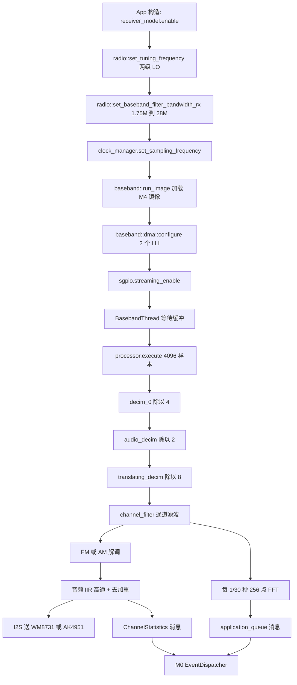
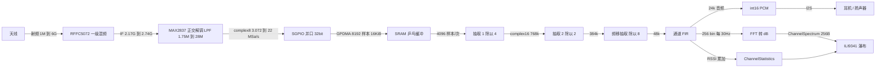

# PortaPack Mayhem 源码详解 03：接收链路与基带

> 涉及文件：
> - `firmware/application/radio.cpp`（687 行，调谐/增益/带宽/方向切换）
> - `firmware/application/tuning.cpp`（470 行，两级 LO 规划）
> - `firmware/application/receiver_model.cpp`（564 行，RX 参数模型）
> - `firmware/baseband/baseband_thread.cpp`（137 行，M4 采集主循环）
> - `firmware/baseband/baseband_dma.cpp`（189 行，GPDMA + SGPIO 乒乓）
> - `firmware/baseband/proc_nfm_audio.cpp`（246 行，NFM 解调链）
> - `firmware/baseband/proc_am_audio.cpp`（227 行，AM/SSB 解调链）
> - `firmware/baseband/proc_wfm_audio.cpp`（284 行，WFM 解调链）
> - `firmware/baseband/proc_capture.cpp`（189 行，IQ 抓取到 SD）
> - `firmware/baseband/proc_wideband_spectrum.cpp`（113 行，频谱扫描）
> - `firmware/baseband/dsp_decimate.hpp`（311 行，抽取器族）
> - `firmware/baseband/spectrum_collector.hpp`（256 bin 频谱收集）
>
> 相关 KB：[receiver_model.md](../../../05-学习笔记与知识库/Knowledge-Base/mayhem/receiver_model.md)、[baseband_processor.md](../../../05-学习笔记与知识库/Knowledge-Base/mayhem/baseband_processor.md)

---

## 1. 接收链全景（采样率与带宽）

HackRF One 的接收链是**两级变频**：

```
天线 → RF 开关/滤波 → RFFC5072（一级混频，30 MHz–6 GHz）
     → MAX2837（二级正交解调，2.17–2.74 GHz 直接变频）
     → 8 bit I/Q（SGPIO 并口）→ CPLD → GPDMA → M4
```

`tuning::config::create()` 负责把目标频率拆成两级 LO（`tuning.cpp:328-460`）：

| 频段（HackRF One） | 一级 LO（RFFC5072） | 二级 LO（MAX2837） | 混频极性 |
|---|---|---|---|
| 低频 < 2170 MHz | `f + (2650 MHz − f/7)` | `2650 MHz − f/7` | 反相 |
| 中频 2170–2740 MHz | 0（旁路） | `f` | 不反相 |
| 高频 > 2740 MHz | `f − (f − 2650 MHz)` | 2650 MHz | 反相 |

低频段公式在 `tuning.cpp:370-373`：

```cpp
    const rf::Frequency second_lo_frequency = 2650'000'000 - (target_frequency / 7);
    const rf::Frequency first_lo_frequency = target_frequency + second_lo_frequency;
    const bool mixer_invert = true;
    return {first_lo_frequency, second_lo_frequency, rf::path::Band::Low, mixer_invert};
```

为什么除以 7：二级 LO 固定落在 2650 MHz 附近，一级 LO = 2650 + 6f/7（f 为 0 时约 2.65 GHz，f = 2 GHz 时约 4.36 GHz），从而避开二级 LO 的 2.17–2.74 GHz 直接接收窗口，
同时让镜像频率落到低通滤波器阻带（`rf_path` 会在低频段开 LPF、高频段开 HPF，
`rf_path.cpp:91-122`）。

## 2. 采样率是怎么定的

### 2.1 应用层请求的"带宽"= 采样率

在 HackRF 的架构里，**complex 采样率数值上等于瞬时带宽**（I/Q 两路各 fs 个样本）。
Mayhem 用"带宽档位"暴露给用户，再换算成实际采样率：

| 用户选择带宽 | oversample | 实际采样率（ADC/AFE） | 典型用途 |
|---|---|---|---|
| 12.5 kHz | ×64 | 800 kSa/s | 窄带 CW/莫尔斯 |
| 25 kHz | ×32 | 800 kSa/s | NFM 窄带 |
| 100 kHz | ×16 | 1.6 MSa/s | NFM |
| 250 kHz | ×8 | 2 MSa/s | NFM/WFM |
| 500 kHz | ×8 | 4 MSa/s | WFM/抓取 |
| 1.25 MHz | ×4 | 5 MSa/s | 宽 WFM |
| 2.5 MHz | ×4 | 10 MSa/s | IQ 抓取 |
| 5.5 MHz | ×4 | 22 MSa/s | 宽带抓取 |

换算函数 `get_oversample_rate()`（`firmware/common/oversample.hpp:60-67`）：

```cpp
inline OversampleRate get_oversample_rate(uint32_t sample_rate) {
    if (sample_rate < 25'000) return OversampleRate::x64;    // 12k5, 16k.
    if (sample_rate < 80'000) return OversampleRate::x32;    // 25k,  32k, 50k, 75k.
    if (sample_rate < 250'000) return OversampleRate::x16;   // 100k, 150k.
    if (sample_rate < 1'250'000) return OversampleRate::x8;  // 250k, 500k, 600k, 750k, 1Mhz.

    return OversampleRate::x4;  // Top range (1.25Mhz ... 5.5Mhz).
}
```

低采样率必须**过采样再抽取**，因为 MAX2837 的模拟 LPF 最窄只能到 1.75 MHz
（`hw/max283x.hpp:74-92` 的 16 档带宽表，从 1.75 MHz 到 28 MHz）。
`filter_bandwidth_for_sampling_rate()`（`ui/ui_spectrum.cpp:521-556`）把实际采样率映射到最近的
LPF 档位，例如 ≤3.5 MSa/s → 1.75 MHz，4–7 MSa/s → 2.5 MHz，16 MSa/s → 5.5 MHz。

### 2.2 音频类 App 为什么固定 3.072 MSa/s

`NarrowbandFMAudio::baseband_fs = 3072000`（`proc_nfm_audio.hpp`），`NarrowbandAMAudio`
与 `WidebandFMAudio` 同样。原因：

- 3.072 MHz = 48 kHz × 64，整条链的每一级都是整数抽取：÷4 → 768 k，÷2 → 384 k，÷8 → 48 k，
  再 ÷2 → 24 k（NFM）或 ÷4 → 12 k（AM）。**没有任何分数重采样**，省掉一个重采样器。
- 3.072 MSa/s 也高于 HackRF 建议的 2 MSa/s 下限，模拟 LPF 可以稳定工作在 2.5 MHz 档。

## 3. 从 SGPIO 到 M4 内存：GPDMA 乒乓

`baseband_dma.cpp:90-105`：

```cpp
constexpr size_t buffer_samples_log2n = 13;
constexpr size_t buffer_samples = (1 << buffer_samples_log2n);
constexpr size_t transfers_per_buffer_log2n = 2;
constexpr size_t transfers_per_buffer = (1 << transfers_per_buffer_log2n);
constexpr size_t transfer_samples = buffer_samples / transfers_per_buffer;
constexpr size_t transfers_mask = transfers_per_buffer - 1;

constexpr size_t buffer_bytes = buffer_samples * sizeof(baseband::sample_t);
constexpr size_t transfer_bytes = transfer_samples * sizeof(baseband::sample_t);

constexpr size_t msg_count = transfers_per_buffer - 1;

static std::array<gpdma::channel::LLI, transfers_per_buffer> lli_loop;
static constexpr auto& gpdma_channel_sgpio = gpdma::channels[portapack::sgpio_gpdma_channel_number];
```

| 量 | 值 | 说明 |
|---|---|---|
| `buffer_samples` | 8192 | 一个"缓冲区"的总样本数 |
| `transfer_samples` | 4096 | 单次 DMA 传输的样本数（LLI 粒度） |
| `buffer_bytes` | 16 384 B | 8192 × 2 B（complex8） |
| `transfer_bytes` | 8 192 B | 4096 × 2 B |
| LLI 数量 | 2 | 环形链表，传输完成中断切下一个 |

`wait_for_buffer()`（`baseband_dma.cpp:166-186`）负责"等到一块已经填满、且上一轮已消费"的缓冲：

```cpp
baseband::buffer_t wait_for_buffer() {
#ifdef PRALINE
    shared_memory.m4_dma_wait_count++;  // Phase 0 instrumentation
#endif

    const auto next_index = thread_wait.sleep();
    buffer_handled++;

    auto buffer_missed = buffer_transfered - buffer_handled;
    shared_memory.m4_buffer_missed = buffer_missed;

    if (next_index >= 0) {
        const size_t free_index = (next_index + transfers_per_buffer - 2) & transfers_mask;
        const auto src = lli_loop[free_index].srcaddr;
        const auto dst = lli_loop[free_index].destaddr;
        const auto p = (src == reinterpret_cast<uint32_t>(&LPC_SGPIO->REG_SS[0])) ? dst : src;
        return {reinterpret_cast<sample_t*>(p), transfer_samples};
    } else {
        return {};
    }
}
```

- `thread_wait.sleep()` 在中断里被 `transfer_complete()` 唤醒（`:110-117`），传回"下一个 LLI 索引"。
- `free_index = (next_index + 0) & 1`——因为只有 2 个 LLI，**当前正在填的那个不能碰**，所以要回退一个。
- `buffer_missed` 直接写进共享区，UI 的 Debug 界面可读；**它 > 0 就说明 M4 处理不过来**。

## 4. M4 主循环与时间预算

`baseband_thread.cpp:79-137`：

```cpp
void BasebandThread::run() {
    baseband_sgpio.init();
    baseband::dma::init();

    const auto baseband_buffer = std::make_unique<std::array<baseband::sample_t, 8192>>();
    baseband::dma::configure(baseband_buffer->data(), direction());
    // baseband::dma::allocate(4, 2048);

    baseband_sgpio.configure(direction());
    baseband::dma::enable(direction());
    baseband_sgpio.streaming_enable();
    ...
    while (!chThdShouldTerminate()) {
        ...
        const auto buffer_tmp = baseband::dma::wait_for_buffer();
        if (buffer_tmp) {
            buffer_c8_t buffer{
                buffer_tmp.p, buffer_tmp.count, sampling_rate_};

            if (shared_memory.request_m4_performance_counter == 0x02) {
                uint8_t max = shared_memory.m4_performance_counter;
                for (size_t i = 0; i < buffer_tmp.count; i++) {
                    int8_t a = buffer_tmp.p[i].real();
                    if (a < 0)
                        a = -a;

                    if (a > max)
                        max = a;
                }

                shared_memory.m4_performance_counter = max;
            }

            if (baseband_processor_) {
                if (shared_memory.radio_tx_drain == 0) {  // only generate if not draining.
                    baseband_processor_->execute(buffer);
                }
            }
            ...
```

时间预算（M4 @200 MHz，单次 `execute()` 处理 **4096** 个 complex8 样本）：

| 采样率 | 4096 样本周期 | 可用周期 @200 MHz | 说明 |
|---|---|---|---|
| 3.072 MSa/s | 1.333 ms | 266 667 | 音频类 App 的常态，余量充足 |
| 10 MSa/s | 409.6 µs | 81 920 | 抓取 2.5 MHz 带宽 |
| 20 MSa/s | 204.8 µs | 40 960 | 极限，代码注释也承认"periodical M4 samples drop" |

以 24 抽头复数 FIR 抽取 8 倍为例：输出 4096/8 = 512 点，乘法量 ≈ 24 × 512 = 12 288 次复数乘加
（约 4 次实数乘 + 4 次加）≈ 10 万条指令量级，而预算是 40 960 周期——**这就是 20 MSa/s 下丢样本的
直接原因**，也是 `proc_capture.cpp:131-135` 里"高采样率时降低瀑布更新频率"的原因。

> 注：`proc_wideband_spectrum.cpp:33-34` 的注释写"2048 complex8_t samples per buffer, 102.4us"，
> 与 `transfer_samples = 4096` 不符——这是**过期注释**（早期 `transfers_per_buffer = 4` 时留下的），
> 以常量表为准。读代码时不要被它带偏。

## 5. 三级抽取：三种解调链的对照

### 5.1 NFM（`proc_nfm_audio.cpp`）

| 级 | 类 | 抽取 | 输入 → 输出 | 抽头数 |
|---|---|---|---|---|
| decim_0 | `FIRC8xR16x24FS4Decim4` | ÷4 | 3.072 M → 768 k | 24（real taps，复数输入） |
| audio_decim_0 | `FIRC16xR16x16Decim2` | ÷2 | 768 k → 384 k | 16 |
| translating_decim_1 | `FrequencyTranslatingDecimator32By8` | ÷8 | 384 k → 48 k | 32（含频移） |
| channel_filter | `FIRAndDecimateComplex` | ÷`channel_decimation`（NFM 固定 2） | 48 k → 24 k | 32 |

`proc_nfm_audio.cpp:190-220` 的配置代码把每条链的采样率**显式算出来**，而不是硬编码：

```cpp
void NarrowbandFMAudio::configure(const NBFMConfigureMessage& message) {
    constexpr size_t decim_0_input_fs = baseband_fs;
    constexpr size_t decim_0_output_fs = decim_0_input_fs / decim_0.decimation_factor;

    constexpr size_t audio_decim_0_output_fs = decim_0_output_fs / 2;
    constexpr size_t decim_1_output_fs =
        audio_decim_0_output_fs / translating_decim_1.decimation_factor;
    constexpr size_t channel_filter_input_fs = decim_1_output_fs;
    const size_t channel_filter_output_fs = channel_filter_input_fs / message.channel_decimation;

    const size_t demod_input_fs = channel_filter_output_fs;

    configure_fs4(message.decim_0_filter.taps);
    audio_decim_0.configure(taps_audio_wide_halfband_0.taps);
    translating_decim_1.configure(
        message.decim_1_filter.taps, audio_decim_0_output_fs);
    channel_filter.configure(message.channel_filter.taps, message.channel_decimation);
    demod.configure(demod_input_fs, message.deviation);
```

`configure_fs4()` 还负责 **1/4 采样率搬移方向**（Praline 专属，HackRF One 上 `Shift::Down` 无实际作用）：

```cpp
void NarrowbandFMAudio::configure_fs4(const std::array<int16_t, 24>& taps) {
    // Keep the short first-stage update coherent with the processing thread.
    chSysLock();
    decim_0_taps_ = taps;
    const auto direction = requested_fs4_direction_.load(std::memory_order_relaxed);
    using Shift = dsp::decimate::FIRC8xR16x24FS4Decim4::Shift;
    decim_0.configure(decim_0_taps_, 33554432,
                      direction == RxFs4Direction::Up ? Shift::Up : Shift::Down);
    applied_fs4_direction_ = direction;
    chSysUnlock();
}
```

注意 `chSysLock()`：抽头数组在消息线程（同一 M4 的事件线程）里被改写，而 `execute()` 在另一个
线程读它，必须关中断/调度器临界区。**这是整个基带里少数几处显式加锁的地方**。

### 5.2 AM / SSB（`proc_am_audio.cpp`）

| 级 | 抽取 | 输入 → 输出 |
|---|---|---|
| decim_0 | ÷4 | 3.072 M → 768 k |
| audio_decim_0 | ÷2 | 768 k → 384 k |
| translating_decim_1 | ÷8 | 384 k → 48 k |
| decim_2 | ÷4（`decim_2_decimation_factor`） | 48 k → 12 k |
| channel_filter | ÷1 | 12 k 音频基带 |

AM 链比 NFM 多一级 `decim_2`，因为 AM/SSB 的音频只需 12 kHz；多一级意味着**多一次 2K8/6K/9K
带宽的通道滤波**，抑制邻道。`AMConfig` 表（`receiver_model.cpp:42-58`）有 12 组：
DSB-9K、DSB-6K、USB-2.8K、LSB-2.8K、CW-0.7K、SSB+FM(Wefax)，以及每组的 zoom ×2 变体。

### 5.3 WFM（`proc_wfm_audio.cpp`）

| 级 | 抽取 | 输入 → 输出 |
|---|---|---|
| decim_0 | ÷4 | 3.072 M → 768 k |
| decim_1 | ÷2（WFM）或 ÷8（NOAA WFMAM） | 768 k → 384 k / 96 k |
| audio_dec_1 | CIC ÷2 | 384 k → 192 k |
| audio_dec_2 | CIC ÷2 | 192 k → 96 k |
| audio_filter | FIR ÷2 | 96 k → 48 k |

`proc_wfm_audio.cpp:54-73` 的注释把每一级的样本数与采样率都写出来了，是**读 DSP 链最好的地图**：

```cpp
    /* 384kHz complex<int16_t>[256]  for wfm
     * -> FM demodulation
     * -> 384kHz int16_t[256] */
    /* TODO: To improve adjacent channel rejection, implement complex channel filter:
     *		pass < +/- 100kHz, stop > +/- 200kHz
     */

    /* 96kHz complex<int16_t>[64]  for wfmam NOAA
     * -> FM demodulation
     * -> 96kHz int16_t[64] */

    auto audio_oversampled = demod.execute(channel, work_audio_buffer);  // fs 384khz wfm , 96khz wfmam for NOAA
```

## 6. 频谱是怎么上屏的

解调链每处理 N 个样本就"喂"一次 `SpectrumCollector`：

- `spectrum_interval_samples = decim_0_output_fs / spectrum_rate_hz`，`spectrum_rate_hz = 30`
  （`proc_nfm_audio.hpp`），即 **每秒 30 次瀑布更新**；
- `SpectrumCollector` 内部用 `BlockDecimator<complex16_t, 256>` 把数据压成 256 点，
  做 256 点 FFT，取对数转成 `ChannelSpectrum{ std::array<uint8_t,256> db }`
  （`message.hpp:389-390`），再 `shared_memory.application_queue.push()`；
- UI 侧 `WaterfallView`/`ChannelView` 消费 `Message::ID::ChannelSpectrumConfig` 与
  `UpdateSpectrum`，把 256 个 dB 值映射成颜色。

`ChannelSpectrum` 只有 **256 B**（256 个 uint8），这是它能塞进 512 B 消息上限的原因。
宽频瀑布（`proc_wideband_spectrum`）则是另一种做法：把两个 1024 点缓冲**逐点相加**降噪，
再交给 FFT（`proc_wideband_spectrum.cpp:42-47`）：

```cpp
    for (size_t i = 0; i < spectrum.size(); i++) {
        // TODO: Removed window-presum windowing, due to lack of available code RAM.
        // TODO: Apply window to improve spectrum bin sidelobes.
        spectrum[i] += buffer.p[i + 0];
        spectrum[i] += buffer.p[i + 1024];
    }
```

## 7. 接收链执行流图



## 8. 数据流图（标出采样率与载体）



## 9. 关键数字速查

| 项目 | 数值 | 出处 |
|---|---|---|
| 基带缓冲 | 8192 样本 / 16 KiB | `baseband_dma.cpp:90-98` |
| 单次 execute 样本数 | 4096 | `transfer_samples` |
| NFM 最终音频 | 24 kHz | `NBFMConfig::apply` → `audio::set_rate(Hz_24000)` |
| AM 最终音频 | 12 kHz | `AMConfig::apply` → `Hz_12000` |
| WFM 最终音频 | 48 kHz | `WFMConfig::apply` → `Hz_48000` |
| 通道频谱 | 256 bin / 30 Hz | `SpectrumCollector`、`spectrum_rate_hz` |
| 宽频瀑布缓冲 | 256 complex16，2 段累加 | `proc_wideband_spectrum.hpp:51`、`.cpp:42-47` |
| 抓取格式 | C8/CU8/C16 | `file.cpp:545-558` |
| 抓取上限 | 约 22 MSa/s（×4 过采样 + 5.5 MHz 带宽） | `ui_spectrum.cpp:521-556`、`oversample.hpp:60-67` |

## 10. 陷阱与实测建议

- **`execute()` 里不能阻塞**：M4 的 `BasebandThread` 优先级 `NORMALPRIO+20`（相对最高），
  但没有任何"缓冲可丢"的保护——一旦超时，`buffer_missed` 增长，音频会"咔哒"。
  在 `execute()` 里加 `chThdSleep*` 是最常见的错误。
- **消息发送是尽力而为**：`MessageQueue::push()` 用 `chMtxTryLock`，拿不到锁直接返回 false
  （`message_queue.hpp:102-116`）。所以基带侧**必须容忍丢消息**，不能假设每条 `ChannelSpectrum`
  都能到 UI。
- **改抽头/抽头数会改采样率链**：`channel_decimation` 是消息里带的（NFM 固定 2），
  改它必须同步改 `demod.configure(demod_input_fs, deviation)` 的采样率，否则解调增益/静噪门限全错。
- **`RxFs4Direction` 只影响 Praline**：HackRF One 没有 FPGA 1/4 搬移，`configure_fs4()` 的
  `Shift` 参数只改变滤波器组的相位选择；读代码时别把它当成通用频移。
- **抓取时 UI 会变慢是正常的**：`proc_capture.cpp:131-135` 在高采样率下主动把
  `spectrum_interval_samples` 除以 `sample_rate/750000`，用更频繁的瀑布换取"看起来不卡"。
- **`m4_buffer_missed` 是最有用的诊断量**：它等于 `buffer_transfered - buffer_handled`，
  在 Debug 覆盖层（`SystemView::toggle_overlay` 第一次按下）里能看到。
