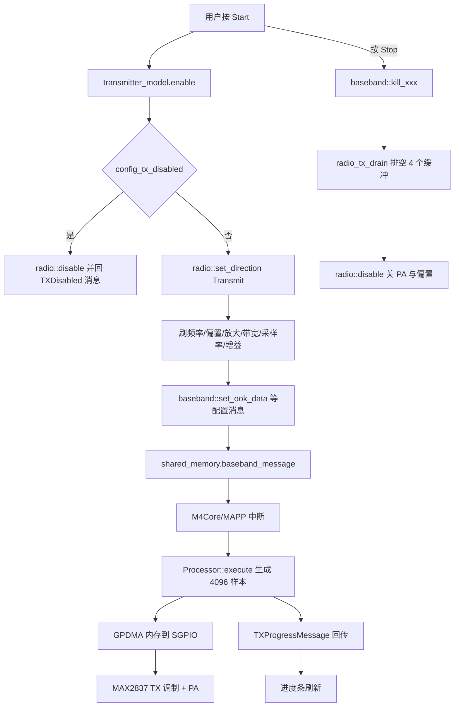
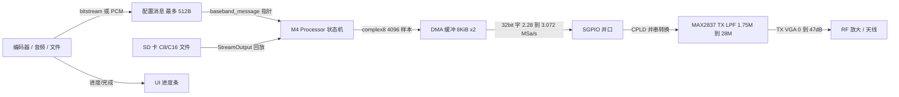

# PortaPack Mayhem 源码详解 04：发射链路与应用

> 涉及文件：
> - `firmware/application/transmitter_model.cpp`（200 行，TX 参数模型）
> - `firmware/application/transmitter_model.hpp`（97 行，`settings_t`）
> - `firmware/application/radio.cpp`（687 行，方向/增益/带宽/排空）
> - `firmware/application/apps/ui_encoders.cpp`（约 350 行，OOK 遥控器发射）
> - `firmware/application/protocols/encoders.hpp`（编码器定义，`OOK_SAMPLERATE`）
> - `firmware/baseband/proc_ook.cpp`（约 260 行，OOK 波形合成）
> - `firmware/baseband/proc_ook.hpp`（90 行，状态机字段）
> - `firmware/baseband/packet_builder.hpp`（接收侧组包器，用于对照）
> - `firmware/baseband/stream_output.cpp`（76 行，文件/流回放输出）
> - `firmware/application/baseband_api.cpp`（640 行，TX 配置消息）
>
> 相关 KB：[transmitter_model.md](../../../05-学习笔记与知识库/Knowledge-Base/mayhem/transmitter_model.md)、[baseband_processor.md](../../../05-学习笔记与知识库/Knowledge-Base/mayhem/baseband_processor.md)

---

## 1. 发射链全景

与接收链相反，TX 是**软件生成波形 → DMA 推给 SGPIO → CPLD/FPGA → MAX2837 调制 → PA**：

```
App 组帧（位流/音频/IQ） → baseband::set_xxx_data() 消息
    → M4 的 Processor::execute() 逐样本填充 buffer_c8_t
    → GPDMA（源=内存，目的=SGPIO）→ CPLD → MAX2837 TX
    → RF 开关/滤波 → 天线
```

关键区别：

| 维度 | RX | TX |
|---|---|---|
| DMA 方向 | SGPIO → 内存 | 内存 → SGPIO（`baseband_dma.cpp:63-66`） |
| 采样率来源 | `NBFMConfigureMessage` 等 | 图像自带（如 OOK 固定 2.28 MSa/s） |
| 数据来源 | 硬件 | `execute()` 实时生成，或 `StreamOutput` 从文件读 |
| 结束条件 | 永续 | 位流发完 / 用户停止 / 排空 |
| 安全限制 | 无 | `config_tx_disabled()` / `config_tx_gain_max_db()` |

## 2. `TransmitterModel`：TX 参数的唯一入口

### 2.1 字段

`transmitter_model.hpp:40-48`：

```cpp
    struct settings_t {
        uint32_t baseband_bandwidth = max283x::filter::bandwidth_minimum;
        uint32_t sampling_rate = 3'072'000;
        uint32_t channel_bandwidth = 1;
        /* Platform default chosen to avoid PRALINE MAX2831 overdrive while
         * preserving legacy HackRF One behavior. */
        uint8_t tx_gain_db = hackrf::one::default_tx_gain_db;
        bool rf_amp = false;
    };
```

| 字段 | 默认值 | 含义 | 硬件落点 |
|---|---|---|---|
| `baseband_bandwidth` | 1.75 MHz（`bandwidth_minimum`） | MAX2837 TX LPF | `radio::set_baseband_filter_bandwidth_tx` |
| `sampling_rate` | 3.072 MSa/s | 基带采样率 | `clock_manager.set_sampling_frequency` |
| `channel_bandwidth` | 1 | **仅保存，不下发**（注释明说 "Doesn't actually affect radio"） | — |
| `tx_gain_db` | 35 dB（HackRF One）/ 16 dB（PRALINE） | TX VGA 增益 | `radio::set_tx_gain` |
| `rf_amp` | false | +14 dB 前端放大 | `radio::set_rf_amp` |

`default_tx_gain_db` 在 `hackrf_hal.hpp:57-61`：

```cpp
#ifdef PRALINE
constexpr int8_t default_tx_gain_db = 16;
#else
constexpr int8_t default_tx_gain_db = 35;
#endif
```

PRALINE 用 16 dB 是因为 MAX2831 的 TX 链路增益更高，35 dB 会过驱。

### 2.2 增益的两道限幅

`transmitter_model.cpp:76-92`：

```cpp
uint8_t TransmitterModel::tx_gain() const {
    if (persistent_memory::config_tx_disabled()) {
        return 0;
    }
    return std::min(settings_.tx_gain_db, portapack::persistent_memory::config_tx_gain_max_db());
}

void TransmitterModel::set_tx_gain(uint8_t v_db) {
    uint8_t newgain = v_db;
    if (persistent_memory::config_tx_disabled()) {
        newgain = 0;
    } else if (v_db > portapack::persistent_memory::config_tx_gain_max_db()) {
        newgain = portapack::persistent_memory::config_tx_gain_max_db();
    }
    settings_.tx_gain_db = newgain;
    update_tx_gain();
}
```

- **读时限幅**：`tx_gain()` 返回 `min(设置值, 全局上限)`，所以 App 改了全局上限后无需重新 set。
- **写时钳位**：`set_tx_gain()` 直接把超限值压到上限，并把"TX 禁用"翻译成 0 dB。
- `radio::set_tx_gain()` 最终写 MAX2837 的 TX VGA，范围 **0–47 dB，步进 1 dB**
  （`hw/max283x.hpp:64-68`）。

`rf_amp()` 还多一道"禁用时强制 false"（`transmitter_model.cpp:94-104`），
避免用户在设置里关掉 TX 后仍能靠残留状态放大。

### 2.3 `enable()` / `disable()`

`transmitter_model.cpp:110-137`：

```cpp
void TransmitterModel::enable() {
    if (portapack::persistent_memory::config_tx_disabled()) {
        radio::disable();

        TXDisabledMessage message;
        EventDispatcher::send_message(message);

        return;
    }

    enabled_ = true;
    radio::set_direction(rf::Direction::Transmit);
    update_tuning_frequency();
    update_antenna_bias();
    update_rf_amp();
    update_baseband_bandwidth();
    update_sampling_rate();
    update_tx_gain();

    signal_token_tick_second = rtc_time::signal_tick_second += [this]() {
        this->on_tick_second();
    };

    if (portapack::persistent_memory::stealth_mode()) {
        DisplaySleepMessage message;
        EventDispatcher::send_message(message);
    }
}
```

要点：

1. **禁用路径提前返回**：发一条 `TXDisabledMessage` 让 UI 弹提示，然后什么都不做。
   这是"合规开关"（设置里的 TX 禁用）。
2. **顺序固定**：先切方向，再依次刷频率、偏置、RF 放大、带宽、采样率、增益。
   因为 `update_*()` 都带 `if (enabled_)` 判断，顺序反了会漏配。
3. **秒级回调**：`rtc_time::signal_tick_second` 是 `Signal<>`，用于 stealth 模式下每秒翻转 TX LED
   （`on_tick_second()`，`:197-200`）。`disable()` 里用 token 精确退订（`:144`），避免悬空 lambda。
4. **stealth 模式自动熄屏**：发 `DisplaySleepMessage`，但基带继续发射——
   这正是 `EventDispatcher::set_display_sleep` 注释里强调"不要因为熄屏就停数据"的原因。

## 3. 一次 OOK 发射的完整生命周期

以 `EncodersView`（`ui_encoders.cpp`）为例：

| 阶段 | 代码 | 动作 |
|---|---|---|
| 构造 | `ui_encoders.cpp:323` | `baseband::run_image(image_tag_ook)` 加载 M4 镜像 |
| 用户按 Start | `:339-342` | `tx_view.set_transmitting(true)` + `start_tx()` |
| 组帧 | `:282-302` | 生成位流、算 `samples_per_bit`、设置进度条上限 |
| 开射频 | `:310` | `transmitter_model.enable()` |
| 下发参数 | `:312-317` | `baseband::set_ook_data(bitstream_length, samples_per_bit, repeat, pause, scan_width)` |
| 用户按 Stop | `:344-348` | `baseband::kill_ook()` + `transmitter_model.disable()` |
| 析构 | `:246-247` | `transmitter_model.disable()` + `baseband::shutdown()` |

组帧的核心是"每个 bit 占多少个采样点"（`ui_encoders.cpp:289-290`）：

```cpp
        samples_per_bit =
            ((view_scan.bit_length_10.value() * 10 + view_scan.bit_length.value()) * OOK_SAMPLERATE) / 1000000UL;
```

`OOK_SAMPLERATE = 2'280'000`（`protocols/encoders.hpp:33`）。例：bit 长度 350 µs →
`350 × 2 280 000 / 1 000 000 = 798` 个采样点/bit。

> 采样率 2.28 MSa/s 不是随便选的：它等于 38 kHz 红外载波的 60 倍（38 000 × 60 = 2 280 000），
> 也让常见的微秒级码元长度落在整数或近似整数的采样点上；同时 < 3.072 MSa/s 以留出 M4 处理余量。

## 4. 基带侧：`OOKProcessor` 如何合成波形

### 4.1 状态字段

`proc_ook.hpp:37-48`：

```cpp
    uint32_t samples_per_bit{0};
    uint8_t repeat{0};
    uint32_t length{0};
    uint32_t pause{0};
    uint8_t de_bruijn_length{0};

    uint32_t pause_counter{0};
    uint8_t repeat_counter{0};
    uint8_t s{0};
    uint16_t bit_pos{0};
    uint8_t cur_bit{0};
    uint32_t sample_count{0};
```

这是一个**逐样本状态机**：每个 `execute()` 调用处理 4096 个样本，内部靠 `sample_count` 决定
"当前 bit 还要保持多少个样本"，靠 `bit_pos` 在 `shared_memory.bb_data.data[]` 里取位。

### 4.2 位 → 波形

`proc_ook.cpp:29-39`：

```cpp
inline void OOKProcessor::write_sample(const buffer_c8_t& buffer, uint8_t bit_value, size_t i) {
    int8_t re, im;
    if (bit_value) {
        re = INT8_MAX;
        im = 0;
    } else {
        re = 0;
        im = 0;
    }
    buffer.p[i] = {re, im};
}
```

OOK 只有两种符号：`{127, 0}`（载波开）与 `{0, 0}`（关）。没有脉冲整形、没有滤波器留，
所以**频谱旁瓣很大**——这正是 OOK 遥控器能被宽带接收机"看见"的原因，也是它不合规风险最高的地方。

配置消息处理（`proc_ook.cpp:207-244`）里有个容易踩的细节：

```cpp
        if (de_bruijn_length) {
            if (!scan_init(de_bruijn_length))
                return;
        } else {
            samples_per_bit /= 10;
        }
```

普通模式把 `samples_per_bit` **除以 10**——因为 App 侧传进来的是"×10 的定点值"
（`ui_encoders.hpp` 的 `samples_per_bit()` 返回 `OOK_SAMPLERATE / (clk_khz/…)` 后再乘 10）。
读这段时如果不追到 App 侧，会以为采样点少了 10 倍。

### 4.3 重复、暂停与进度

- `repeat` 是"总重复次数 − 1"，每发完一遍 `repeat_counter++`，到 `repeat` 后发
  `TXProgressMessage{done=true}`（`proc_ook.cpp:181-182`）；
- `pause` 是每遍之间的静默符号数，靠 `pause_counter` 数样本；
- 进度消息通过 `shared_memory.application_queue.push(txprogress_message)` 回传，
  UI 的 `progressbar` 直接消费。

> `TXProgressMessage` 只有十几字节，但**每条都占用 2 KiB 队列**；高频推送会挤掉频谱消息。
> OOK 的做法是"每发完一遍才推一条"，这是正确姿势。

## 5. 排空（drain）：为什么停发射要等 100 ms

`radio.cpp:477-493`：

```cpp
void disable() {
...
    if (direction == rf::Direction::Transmit && baseband::is_image_running()) {
        static constexpr uint32_t radio_tx_drain_timeout_ms = 100;
        shared_memory.radio_tx_drain = 1;  // Request drain of the current DMA queue.
        for (uint32_t waited_ms = 0;
             shared_memory.radio_tx_drain && (waited_ms < radio_tx_drain_timeout_ms);
             ++waited_ms) {
            chThdSleepMilliseconds(1);
        }
    }
    /* Never allow shutdown to block indefinitely waiting for a drain
     * acknowledgement that may never arrive in normal operation. */
    shared_memory.radio_tx_drain = 0;
```

M4 侧在 `baseband_thread.cpp:120-130` 响应：

```cpp
            if (baseband_processor_) {
                if (shared_memory.radio_tx_drain == 0) {  // only generate if not draining.
                    baseband_processor_->execute(buffer);
                }
            }
            if (shared_memory.radio_tx_drain == 1) {
                buffer_drained++;
                if (buffer_drained >= 4) {             // We have 4 buffers, so after draining 4 we should be safe to disable.
                    shared_memory.radio_tx_drain = 0;  // Clear the drain request to allow normal operation to resume.
                    buffer_drained = 0;
                }
            }
```

设计意图：DMA 队列里可能还有**几毫秒的未发射样本**，如果立刻关 PA，最后一小段波形会被截断
（表现为"最后几个 bit 丢失"）。所以 M0 置 `radio_tx_drain=1`，M4 停止生成新数据并空跑 4 个缓冲
（≈ 4 × 1.33 ms ≈ 5.3 ms @3.072 MSa/s），把队列排空；M0 最多等 100 ms，超时也强制继续。

> 注释说"We have 4 buffers"，但当前 `transfers_per_buffer = 2`（2 个 LLI），
> 这里的 4 是**历史遗留的保守值**——多等两个缓冲没有坏处，只是延时略长。

## 6. 其它发射形态

| 形态 | 基带镜像 | 数据来源 | 采样率 | 说明 |
|---|---|---|---|---|
| OOK 遥控 | `POOK` | `bb_data.data[]` 位流 | 2.28 MSa/s | 逐 bit 电平 |
| AFSK/FSK | `PAFT`/`PFSK` | `set_afsk_data`/`set_fsk_data` | 由 App 定 | 相位连续调制 |
| 音频 TX（麦克风） | `PMTX` | ADC/`AudioInput` | 由 App 定 | FM/AM 调制音频 |
| SSTV/APT | `PSTX`/`PANT` | 像素行缓冲 | 由 App 定 | 逐行扫描 |
| IQ 回放 | `PREP` | SD 卡 `.C8/.C16` 文件 | 文件头 | `StreamOutput` 读文件 |
| 信号源 | `PSIG` | 合成 | 可调 | 单音/扫频 |

`StreamOutput`（`stream_output.cpp`）把文件读取抽象成 `write()` 的反向：基带侧每帧调用
`stream->write(buffer.p, bytes)`，若返回不足说明文件读完/卡慢，App 收到 `ReplayThreadDone` 后停发射。

## 7. 发射任务流图



## 8. 发射数据流图



## 9. 功率与合规相关的量化

| 参数 | 范围 | 出处 |
|---|---|---|
| TX VGA 增益 | 0–47 dB，1 dB 步进 | `hw/max283x.hpp:64-68` |
| HackRF One 默认 | 35 dB | `hackrf_hal.hpp:59-61` |
| PRALINE 默认 | 16 dB | 同上 |
| RF amp | 0 / +14 dB（开关） | `radio::set_rf_amp` |
| 天线偏置 | 3.3 V / 0（软件开关） | `radio::set_antenna_bias` |
| 全局 TX 上限 | 用户设置项 `config_tx_gain_max_db()` | `transmitter_model.cpp:80` |
| 全局 TX 禁用 | `config_tx_disabled()`，优先级最高 | `transmitter_model.cpp:111` |

粗略估算：HackRF One 在 433 MHz、47 dB 满增益下约 **+5…+10 dBm 量级**，35 dB 时低约 12 dB；
加 RF amp 再高约 14 dB。实际值随频段与匹配网络变化很大，**必须用频谱仪/功率计实测**。
**这个功率级别在多数国家属于免许可微功率设备上限附近，天线增益和占空比都会影响合规性。**

## 10. 陷阱与实测建议

- **`transmitter_model.enable()` 与 `baseband::run_image()` 的先后**：必须先加载镜像再
  `set_xxx_data()`，否则消息发给一个不存在的处理器（`baseband_message` 被 M4 清空但没人处理）。
  正确顺序见 `ui_encoders.cpp:323`（构造时 run_image）→ `:310-317`（启动时 enable + 配置）。
- **停发射不等于停基带**：`transmitter_model.disable()` 只关射频；镜像仍在跑，需要
  `baseband::shutdown()` 才释放（析构里通常两者都调）。
- **`samples_per_bit /= 10` 的隐式约定**：App 传的是 ×10 定点值，基带除以 10；
  自己写新 TX App 时照抄这个约定，否则码率差 10 倍。
- **TX 期间 UI 卡顿是设计使然**：`radio_tx_drain` 的自旋最多 100 ms，且
  `set_ook_data` 等消息是同步等待 M4 取走的；不要在 TX 循环里频繁改参数。
- **stealth 模式熄屏但不停发射**：`DisplaySleepMessage` 只关背光与 LCD，
  `EVT_MASK_APPLICATION` 仍会处理（`event_m0.cpp:377-385` 只屏蔽编码器/触摸）。
  这是"隐蔽发射"功能，测试时别以为死机了。
- **频谱纯度**：OOK 的硬开关会在 ±n×码率处产生强旁瓣；要"干净"就用 FSK/GFSK
  或加成形滤波器（当前 OOK 没有）。
- **天线偏置**是给有源天线/LNA 供电的，误开会在天线口输出 3.3 V——接无源天线无害，
  接某些设备可能损坏，务必在设置里确认。
