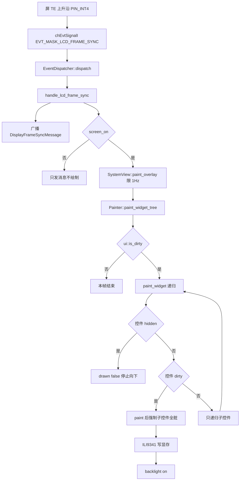
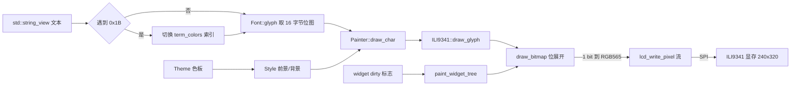

# PortaPack Mayhem 源码详解 05：UI 组件与渲染

> 涉及文件：
> - `firmware/common/ui_widget.hpp`（1177 行，控件类声明）
> - `firmware/common/ui_widget.cpp`（3399 行，控件实现）
> - `firmware/common/ui_painter.hpp` / `.cpp`（95 / 147 行，绘制入口）
> - `firmware/common/ui.hpp` / `ui.cpp`（448 / 125 行，坐标宏、`Color`、`Rect`、`Point`）
> - `firmware/common/ui_text.hpp`（`Glyph`/`Font` 抽象）
> - `firmware/application/ui/ui_font_fixed_8x16.cpp`（约 3600 行数据，默认字体）
> - `firmware/application/ui/ui_font_fixed_5x8.cpp`（约 500 行数据，小字体）
> - `firmware/common/lcd_ili9341.cpp`（886 行，屏驱动）
> - `firmware/application/irq_lcd_frame.cpp`（72 行，TE 帧同步）
> - `firmware/application/theme.cpp` / `theme.hpp`（主题色板）
>
> 相关 KB：[ui_painter.md](../../../05-学习笔记与知识库/Knowledge-Base/mayhem/ui_painter.md)、[app_view.md](../../../05-学习笔记与知识库/Knowledge-Base/mayhem/app_view.md)

---

## 1. 渲染管线一张图

```
Widget 树（逻辑）
   │  dirty 标记
   ▼
Painter（ui_painter.cpp）
   │  draw_string / draw_bitmap / fill_rectangle
   ▼
ILI9341 驱动（lcd_ili9341.cpp）
   │  LCD 命令 + 像素流（SPI/并口）
   ▼
240×320 屏（RGB565）
```

触发时机不是"随时画"，而是**屏的 TE（Tearing Effect）信号**：每帧一次上升沿 → PIN_INT4 →
`EVT_MASK_LCD_FRAME_SYNC` → `handle_lcd_frame_sync()` → `paint_widget_tree()`
（`event_m0.cpp:526-538`）：

```cpp
void EventDispatcher::handle_lcd_frame_sync(bool screen_on) {
    bool waiting_for_frame = this->waiting_for_frame;

    DisplayFrameSyncMessage message;  // send framesync msg all the time, bc some apps relay on it
    message_map.send(&message);
    if (screen_on) {  // only draw when screen is on
        static_cast<ui::SystemView*>(top_widget)->paint_overlay();
        painter.paint_widget_tree(top_widget);
        portapack::backlight()->on();
    }
    if (waiting_for_frame)
        this->waiting_for_frame = false;
}
```

三个细节：

1. **`DisplayFrameSyncMessage` 无条件广播**——很多 App 靠它做节流（例如频谱只在帧边界更新），
   即使屏幕睡着也要发。
2. **`backlight()->on()` 在绘制之后**：唤醒屏幕时先画完再开背光，避免看到花屏。
3. **`paint_overlay()` 在整树之前**：DFU/调试覆盖层要盖在最上面，但它自己限制 1 Hz 刷新
   （`ui_navigation.cpp:1162-1180`）。

## 2. 控件清单（28 个）

| 分组 | 控件 | 用途 | 行号（`ui_widget.hpp`） |
|---|---|---|---|
| 容器 | `View` | 矩形区域 + 子控件 + 背景填充 | 163 |
| 容器 | `OptionTabView` | 顶部标签页 | 1154 |
| 文本 | `Text` / `Labels` | 单行/多标签文本 | 210 / 237 |
| 文本 | `LiveDateTime` | 每秒刷新的时钟 | 262 |
| 文本 | `BigFrequency` | 大号频率显示 | 290 |
| 文本 | `Console` | 可滚动日志（带颜色转义） | 357 |
| 文本 | `TextEdit` / `TextField` | 多行编辑 / 单行输入 | 732 / 781 |
| 按钮 | `Button` / `NewButton` | 触摸按钮 | 422 / 502 |
| 按钮 | `ButtonWithEncoder` | 按钮+旋钮组合 | 458 |
| 按钮 | `Image` / `ImageButton` / `ImageToggle` | 位图按钮/开关 | 547 / 576 / 594 |
| 选择 | `Checkbox` | 复选 | 382 |
| 选择 | `OptionsField` / `ImageOptionsField` | 枚举选择（左右键切换） | 685 / 639 |
| 选择 | `NumberField` / `FloatField` / `SymField` | 数值/符号输入 | 853 / 898 / 946 |
| 指示 | `ProgressBar` / `ActivityDot` / `VuMeter` | 进度/活动/电平 | 327 / 344 / 1137 |
| 指示 | `BatteryTextField` / `BatteryIcon` | 电池 | 803 / 832 |
| 图形 | `Rectangle` / `Waveform` / `GraphEq` | 色块/波形/均衡器 | 192 / 1035 / 1077 |

所有控件的共同点：**没有布局引擎**。位置和尺寸都是构造时写死的 `Rect{ {x,y}, {w,h} }`，
单位是像素；`UI_POS_X(n)`/`UI_POS_Y(n)` 只是"第 n 个字符格"的语法糖
（`ui.hpp:42-68`，1 字符 = 8×16 px）。

## 3. `Painter`：所有绘制的唯一入口

`ui_painter.hpp:66-91` 的 API 只有 8 个方法：

```cpp
class Painter {
   public:
    Painter() {};

    Painter(const Painter&) = delete;
    Painter(Painter&&) = delete;

    int draw_char(Point p, const Style& style, char c, uint8_t zoom_factor = 1);

    int draw_string(Point p, const Style& style, std::string_view text);
    int draw_string(Point p, const Font& font, Color foreground, Color background, std::string_view text);

    void draw_bitmap(Point p, const Bitmap& bitmap, Color background, Color foreground);

    void draw_rectangle(Rect r, Color c);
    void fill_rectangle(Rect r, Color c);
    void fill_rectangle_unrolled8(Rect r, Color c);

    void paint_widget_tree(Widget* w);

    void draw_hline(Point p, int width, Color c);
    void draw_vline(Point p, int height, Color c);

   private:
    void paint_widget(Widget* w);
};
```

`Style` = 字体 + 前景色 + 背景色（`ui_painter.hpp:33-39`）；`Style::invert()` 用于高亮/焦点态。

### 3.1 文本里的颜色转义

`ui_painter.cpp:51-82`：

```cpp
int Painter::draw_string(
    Point p,
    const Font& font,
    Color foreground,
    Color background,
    std::string_view text) {
    bool escape = false;
    size_t width = 0;
    Color pen = foreground;

    for (auto c : text) {
        if (escape) {
            if (c < std::size(term_colors))
                pen = term_colors[(uint8_t)c];
            else
                pen = foreground;
            escape = false;
        } else {
            if (c == '\x1B') {
                escape = true;
            } else {
                const auto glyph = font.glyph(c);
                display.draw_glyph(p, glyph, pen, background);
                const auto advance = glyph.advance();
                p += advance;
                width += advance.x();
            }
        }
    }

    return width;
}
```

- `\x1B` + 1 字节索引 → `term_colors[16]`（CGA 16 色，`ui.cpp:41-57`）。
- 宏 `STR_COLOR_RED` 等就是 `"\x1B\x0C"` 这样的两字节串（`ui.hpp:71-87`）。
- **不计入宽度**：转义序列不占字符格，但会让 `draw_string` 的返回宽度与实际像素不符——
  需要精确排版时不能混用颜色转义。

### 3.2 位图与字形

`Painter::draw_char()` 只做三件事：取字形、交给 `display.draw_glyph()`、返回 advance
（`ui_painter.cpp:39-45`）。真正的位展开在 `ILI9341::draw_bitmap()`（`lcd_ili9341.cpp:733-795`）：

```cpp
    if (zoom_level <= 1) {
        // Not a transparent background
        if (ui::Color::magenta().v != background.v) {
            lcd_start_ram_write(p, size);

            const size_t count = size.width() * size.height();
            for (size_t i = 0; i < count; i++) {
                const auto pixel = pixels[i >> 3] & (1U << (i & 0x7));
                io.lcd_write_pixel(pixel ? foreground : background);
            }
        } else {
            ...
```

要点：

- 位图是 **1 bit/像素、行优先、LSB 在前**（`i >> 3` 取字节，`1 << (i & 7)` 取位）。
- **品红（magenta）是透明色**：背景色为 `Color::magenta()` 时跳过 0 位，只画 1 位。
- 非缩放路径只设置**一次** RAM 写窗口，然后连续写 `w×h` 个像素——效率最高。
- 缩放路径（`zoom_level > 1`）退化成"每个像素一次 `fill_rectangle`"（`:769-789`），
  每次都要重设窗口，**慢一个数量级**。大字号标题慎用 zoom。

## 4. 字体：位图字库

| 字体 | 尺寸 | 起始字符 | 字形数 | 每字形字节 | 总 Flash |
|---|---|---|---|---|---|
| `font::fixed_8x16` | 8×16 | 0x20（空格） | 223 | 16（16 行 × 1 B） | 3 568 B |
| `font::fixed_5x8` | 5×8 | 0x20 | 95 | 5（8 行 × 5 bit 打包） | 475 B |

`ui_font_fixed_8x16.cpp` 末尾：

```cpp
const ui::Font fixed_8x16{
    8,
    16,
    fixed_8x16_glyph_data,
    0x20,
    223,
};
```

`Font` 的构造函数签名是 `Font(w, h, data, c_start, count)`（`ui_text.hpp:76-88`）。
`glyph(c)` 用 `c - c_start` 直接索引，**越界字符（如中文）会画成乱码或越界读**——
这也是整个 UI 只有 ASCII 的原因。

`Glyph::advance()` 返回 `{w_, 0}`（`ui_text.hpp:60-62`），即**等宽**：每个字符占 8×16。
所以 240 px 宽最多 30 个字符，320 px 高最多 20 行（扣除状态栏/信息栏后实际 18 行）。

## 5. 屏驱动：ILI9341 的几个关键点

| 能力 | 实现 | 行号 |
|---|---|---|
| 分辨率自适应 | 读 ID `5537894` 判 PortaRF（320×480），否则 240×320 | `lcd_ili9341.cpp:366-394` |
| 旋转 | `MADCTL`（0x36）切横/竖屏，横屏时 320×240 | `:830-857` |
| 局部填充 | `lcd_start_ram_write(rect)` + 连续写像素 | `:408-424` |
| 滚动 | 垂直滚动区（瀑布用），`scroll_set_area/scroll` | `:804-828` |
| 位图 | 见 3.2 | `:733-795` |
| 读像素 | `read_pixels` 用于 H 版检测 | `:722-731` |
| 睡眠/唤醒 | `sleep(bool hw_sleep)` / `wake` | `:400-406` |

`fill_rectangle_unrolled8()`（`:417-424`）是 `fill_rectangle` 的优化版：驱动层用
`lcd_write_pixels_unrolled8` 一次展开 8 个像素，减少循环开销，用于大面积清屏/背景。

横屏切换会**先按竖屏尺寸重设滚动区再改 MADCTL**（`:836-843` 的注释），
否则滚动偏移会把画面"剪切"成斜的。

## 6. 刷新策略：三级 dirty

| 层级 | 机制 | 代码 |
|---|---|---|
| 全局 | `static bool ui_dirty`，任何 `set_dirty()` 置真 | `ui_widget.cpp:47-57` |
| 控件 | `flags.dirty` 位 | `ui_widget.hpp:145` |
| 绘制 | `paint_widget()`：父脏→子全脏；父净→只递归 | `ui_painter.cpp:122-145` |

`paint_widget_tree()` 只在 `ui::is_dirty()` 为真时才动手（`ui_painter.cpp:115-120`），
否则整帧什么都不做——**空闲时 CPU 不花在重绘上**。

为什么需要"全局 dirty"这一层？因为 `EventDispatcher` 每帧都调 `paint_widget_tree()`，
如果每次都遍历整棵树判断每个控件的 dirty，600 个控件的递归本身就要几百微秒；
一个全局标志把"完全没变化"的帧降到一次布尔判断。

## 7. 一帧的时序预算

屏 240×320 = 76 800 像素。以 16 bit/像素计，整屏 = 153 600 B。
即使 SPI 时钟 50 MHz，整屏也要 **24.6 ms**（153 600 × 8 / 50 M）——超过 60 Hz 帧周期（16.7 ms）。
所以：

- **绝不做整屏重绘**。默认 `View::paint()` 只填自己的矩形，子控件各自画自己的区域；
- 一个全屏 `Rectangle` 变脏 → 所有子控件强制重绘 → 一帧画满 76 800 像素 → 掉帧；
- 实测：修改主题色、切换全屏背景这类操作会有明显的"刷"一下，就是整屏重绘。

单字符成本：8×16 = 128 像素，`draw_bitmap` 非缩放路径是 128 次 `lcd_write_pixel`。
30×18 = 540 个字符的满屏文本 ≈ 69 120 次写像素，接近整屏。

## 8. 渲染执行流图



## 9. 数据流图：字符串到像素



## 10. 陷阱与实测建议

- **不要在 `paint()` 里做事**：`paint()` 每帧可能被调用，里面做 I2C 读、文件读、`chThdSleep`
  会直接把帧率拖到个位数。要更新数据用消息 + `set_dirty()`。
- **`set_dirty()` 要打在"变化的最小控件"上**。打在根 `View` 上等于整屏重绘。
- **透明位图必须用 `Color::magenta()` 作背景**，且只能用于 zoom ≤ 1 的路径；
  zoom > 1 时透明判断是逐像素的，但每像素一次 `fill_rectangle`，非常慢。
- **字体只有 ASCII**：`Font::glyph(c)` 不检查范围。显示非 ASCII（UTF-8 多字节）会越界读
  Flash 数据，表现为随机花纹。所有 UI 文案必须是纯 ASCII（工程里确实如此）。
- **`fill_rectangle` 会与屏幕矩形求交**（`lcd_ili9341.cpp:408-415`），
  所以子控件画到屏幕外不会崩，但会浪费 SPI 带宽。
- **横屏/竖屏切换要重设滚动区**（`set_landscape()` 的顺序不能改），否则瀑布会斜切。
- **`wait_finish_frame()` 是 5 ms 轮询**（`event_m0.cpp:540-545`），
  用它"等一帧画完"最坏会多等 5 ms；高频调用会让 App 变慢。
- 调试渲染问题的顺序：先确认 `ui_dirty` 是否被置真（`is_dirty()`），再看目标控件
  `dirty()` 是否为真，最后看 `paint()` 是否真的写了像素。三层任何一层断了都表现为"画面不动"。
