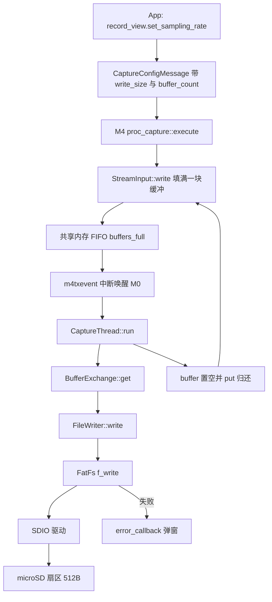
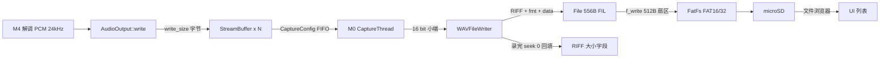

# PortaPack Mayhem 源码详解 06：存储与文件格式

> 涉及文件：
> - `firmware/application/sd_card.cpp` / `.hpp`（76 / 50 行，SD 挂载与热插拔）
> - `firmware/application/file.hpp` / `.cpp`（368 / 645 行，C++ 文件系统封装）
> - `firmware/application/file_path.cpp` / `.hpp`（约 80 / 60 行，所有目录常量）
> - `firmware/application/capture_thread.cpp` / `.hpp`（约 90 / 80 行，抓取落盘线程）
> - `firmware/baseband/stream_input.cpp`（75 行，M4 侧写缓冲）
> - `firmware/application/io_wave.cpp` / `.hpp`（约 230 / 180 行，WAV 读写）
> - `firmware/application/app_settings.cpp` / `.hpp`（设置 .ini 读写）
> - `firmware/application/freqman_db.cpp`（约 430 行，频率文件解析）
> - `firmware/common/ffconf.h`（FATFS 配置）
> - `firmware/common/message.hpp`（`CaptureConfig`，894-921 行）
>
> 相关 KB：[sd_card.md](../../../05-学习笔记与知识库/Knowledge-Base/mayhem/sd_card.md)

---

## 1. 存储栈全景

```
应用（File/FileWriter/WAVFileReader/directory_iterator）
   │  std::filesystem 风格 API（自定义的微型实现，见 file.hpp）
   ▼
CaptureThread / ReplayThread（M0 线程，1024 B 栈）      M4 基带（无 FATFS 调用）
   │  BufferExchange（共享内存里的 FIFO）  ◄───────────  StreamInput::write
   ▼
FatFs（ff.c/ff.h，_FS_REENTRANT = 1）
   │  diskio → SDIO
   ▼
microSD 卡（FAT16/FAT32，扇区 512 B）
```

一个容易被忽略的设计：**M4 不直接写 SD**。抓取时 M4 只把样本写进共享内存里的缓冲队列，
M0 的 `CaptureThread` 负责 `f_write`。原因：

- FATFS 需要较大的栈与堆（`File` 对象 556 B，`FIL` 内含 512 B 扇区缓冲）；
- SD 写入延迟不确定（几十 ms 级），会破坏 M4 的实时性；
- FATFS 的锁（`_FS_REENTRANT`）用 M0 的 ChibiOS 信号量实现，M4 侧没有这套运行时。

## 2. SD 卡的挂载与热插拔

`sd_card.cpp:38-70`：

```cpp
FRESULT mount() {
    return f_mount(&fs, reinterpret_cast<const TCHAR*>(_T("")), 1);
}

} /* namespace */

Signal<Status> status_signal;

void poll_inserted() {
    const auto card_present_now = sdcIsCardInserted(&SDCD1);
    if (card_present_now != card_present) {
        card_present = card_present_now;

        Status new_status{card_present ? Status::Present : Status::NotPresent};

        if (card_present) {
            if (sdcConnect(&SDCD1) == CH_SUCCESS) {
                if (mount() == FR_OK) {
                    new_status = Status::Mounted;
                } else {
                    new_status = Status::MountError;
                }
            } else {
                new_status = Status::ConnectError;
            }
        } else {
            sdcDisconnect(&SDCD1);
        }

        status_ = new_status;
        status_signal.emit(status_);
    }
}
```

| 状态 | 值 | 含义 |
|---|---|---|
| `IOError` | −3 | 底层读写失败 |
| `MountError` | −2 | `f_mount` 失败（卡格式不对/坏卡） |
| `ConnectError` | −1 | `sdcConnect` 失败（卡未初始化） |
| `NotPresent` | 0 | 无卡 |
| `Present` | 1 | 有卡但未挂载 |
| `Mounted` | 2 | 可用 |

- `poll_inserted()` 由 **1 Hz 的 RTC tick** 调用（`event_m0.cpp:407`），所以插卡后最多延迟 1 s 才可用。
- `f_mount(&fs, "", 1)` 的卷路径是空串，即**根目录**；整个固件只挂载一个卷（`_VOLUMES = 1`）。
- `status_signal` 是 `Signal<Status>`，状态栏的 `SDCardStatusView` 订阅它刷新图标。

FATFS 配置（`ffconf.h`）里几个决定性参数：

| 宏 | 值 | 影响 |
|---|---|---|
| `_FS_REENTRANT` | 1 | 线程安全，`_FS_TIMEOUT` = 1000 tick |
| `_USE_LFN` | 3 | 长文件名，静态 BSS 缓冲（不占栈，但**非可重入**） |
| `_MAX_SS` | 512 | 扇区大小 = 块上限 |
| `_CODE_PAGE` | 437 | 只支持 ASCII 文件名 |
| `_FS_TINY` | 0 | 每个 `FIL` 自带 512 B 缓冲（`File` 556 B 的来源） |
| `_USE_FASTSEEK` | 1 | 大文件顺序读更快 |

## 3. SD 卡目录布局

`file_path.cpp:25-61` 定义了全部目录常量（都是 UTF-16 字符串）：

| 目录 | 用途 | 典型文件 |
|---|---|---|
| `APPS/` | 外部 App（`.ppma`） | `ADSBRx.ppma` |
| `CAPTURES/` | IQ 抓取 | `CAP_0001.C16` |
| `FREQMAN/` | 频率列表 | `AIRBAND.TXT` |
| `SETTINGS/` | 每个 App 的 `.ini` | `tx_ook.ini` |
| `WAV/` | 录音 | `REC_0001.WAV` |
| `AUDIO/` | 音频素材 | — |
| `SPECTRUM/`、`WATERFALLS/` | 频谱图/瀑布数据 | — |
| `SCREENSHOTS/` | 截屏 PNG | `SCR_0001.PNG` |
| `SPLASH/` | 开机图 BMP | — |
| `OOKFILES/`、`SUBGHZ/`、`KEELOQKEYS/`、`KEELOQREMOTES/` | 遥控器码库 | — |
| `ADSB/`、`AIS/`、`APRS/`、`GPS/`、`TPMS/`、`EPIRB/` | 解码结果/数据库 | `icao.txt` 等 |
| `LOOKINGGLASS/`、`BLERX/`、`BLETX/`、`SSTV/`、`MACADDRESS/` | 各 App 私有 | — |
| `LOGS/`、`DEBUG/`、`FIRMWARE/` | 日志/调试/固件 | — |

路径拼接用自定义的 `std::filesystem::path`（`file.hpp:69-162`），内部是 `std::u16string`，
因为 FatFs 的 `TCHAR` 在 `_LFN_UNICODE` 下是 16 位。

## 4. 文件格式详解

### 4.1 IQ 抓取：`.C8` / `.CU8` / `.C16`

**裸样本、无文件头**。扩展名决定样本格式（`file.cpp:545-558`）：

```cpp
bool is_cxx_capture_file(const path& filename) {
    auto ext = filename.extension();
    return path_iequal(c8_ext, ext) || path_iequal(cu8_ext, ext) || path_iequal(c16_ext, ext);
}

uint8_t capture_file_sample_size(const path& filename) {
    if (path_iequal(filename.extension(), c8_ext))
        return sizeof(complex8_t);
    if (path_iequal(filename.extension(), cu8_ext))
        return sizeof(complexu8_t);
    if (path_iequal(filename.extension(), c16_ext))
        return sizeof(complex16_t);
    return 0;
}
```

| 扩展名 | 每样本 | 排列 | 典型速率 |
|---|---|---|---|
| `.C8` | 2 B（int8 I + int8 Q） | I,Q,I,Q… | ≥1.5 MHz 带宽 |
| `.CU8` | 2 B（uint8，偏置 127.5） | I,Q… | 与 `.C8` 相同，兼容某些工具 |
| `.C16` | 4 B（int16 I + int16 Q） | I,Q… | ≤1.25 MHz 带宽 |

**采样率不在文件里**，靠文件名旁注或用户记忆——这是 HackRF 生态的历史约定
（`hackrf_transfer` 同样输出裸 IQ）。回放时必须手动指定采样率。

### 4.2 音频：WAV（16 bit 单声道 PCM）

`io_wave.hpp:33-99` 用三个 POD 结构体拼出标准 RIFF 头：

```cpp
struct fmt_pcm_t {
    constexpr fmt_pcm_t(
        const uint32_t sampling_rate)
        : nSamplesPerSec{sampling_rate},
          nAvgBytesPerSec{nSamplesPerSec * 2}  // nBlockAlign = 2
    {
    }

   private:
    uint8_t ckID[4]{'f', 'm', 't', ' '};
    uint32_t cksize{16};
    uint16_t wFormatTag{0x0001};
    uint16_t nChannels{1};
    uint32_t nSamplesPerSec;
    uint32_t nAvgBytesPerSec;
    uint16_t nBlockAlign{2};
    uint16_t wBitsPerSample{16};
};
```

文件结构：

| 偏移 | 内容 | 大小 |
|---|---|---|
| 0 | `RIFF` + size + `WAVE` | 12 B |
| 12 | `fmt ` 块（PCM，单声道，16 bit） | 24 B |
| 36 | `data` 块头 | 8 B |
| 44 | PCM 样本（小端 int16） | N × 2 B |
| 44+N | `LIST/INFO`（IART=`PortaPack`、INAM=标题） | 变长 |

写入时先写占位头，录完再 `seek(0)` 回填 `data` 大小（`io_wave.cpp:174-195` 的 `update_header()`）。
所以**录音中断（拔卡/断电）会留下 size 为 0 的 WAV**，播放器会认为没有音频数据。

### 4.3 频率表：`.TXT`（FreqMan 格式）

`freqman_db.cpp:367-417` 的 `parse_freqman_entry()` 逐列解析 `key=value`：

| 键 | 含义 | 示例 |
|---|---|---|
| `f=` | 单频（MHz） | `f=145.500` |
| `a=` + `b=` | 扫描范围（起/止） | `a=144.000,b=146.000` |
| `r=` + `t=` | 中继接收/发射 | `r=145.000,t=145.600` |
| `l=` + `t=` | 中继监听/发射 | `l=433.920,t=434.920` |
| `m=` | 调制方式 | `m=NFM` |
| `bw=` | 带宽 | `bw=12k5` |
| `s=` | 步进 | `s=25k` |
| `c=` | 亚音（CTCSS/DCS） | `c=88.5` |
| `d=` | 描述（≤30 字符） | `d=Local repeater` |

一条记录一行，逗号分隔，`#` 开头为注释：

```
f=433.920,m=OOK,bw=20k,d=Remote socket
a=144.000,b=146.000,m=NFM,bw=12k5,s=25k,d=2m band
```

解析器**不校验字段顺序**，但 `bw=` 依赖 `m=` 先出现（注释明说 "Requires modulation to be set first"），
所以写文件时 `m=` 必须在 `bw=` 前面。

### 4.4 App 设置：`SETTINGS/<app>.ini`

`app_settings.cpp:43-45`：

```cpp
fs::path get_settings_path(const std::string& app_name) {
    return settings_dir / app_name + u".ini";
}
```

格式是 `key=value` + CRLF（`app_settings.cpp:80-118` 的 `BoundSetting::write`）。
支持 i64/u64/i32/u32/u8/string/bool/float 八种类型；float 固定 6 位小数。

`SettingsManager` 是 RAII：构造时加载，析构时（若启用）保存。典型用法：

```cpp
    app_settings::SettingsManager settings_{
        "tx_ook", app_settings::Mode::TX};
```

`Mode::TX` 决定是否连带保存 radio 参数（频率/增益/带宽），这部分受全局 "save app settings" 开关控制。

### 4.5 其它格式

| 文件 | 格式 | 说明 |
|---|---|---|
| `.BMP`（SPLASH） | 1/4/8/24 bit 位图，RLE4 可选 | `lcd_ili9341.cpp:450-660` 自写解码器 |
| `.PNG`（SCREENSHOTS） | 标准 PNG（zlib 存储/固定 Huffman） | `common/png_writer.cpp` |
| `.PPL` / `.PPM` | 回放列表 / 外部 App | 文本 |
| `.TXT`（KEELOQKEYS） | 每行一个密钥 | — |
| `.TXT`（ADSB） | ICAO 地址 + 机型 | `dump1090.hpp` 里的 `icao_db` |

## 5. 抓取的完整数据通路

```
M4: proc_capture::execute()
   → StreamInput::write()  ── 写满一块 StreamBuffer ──┐
   → creg::m4txevent::assert_event()                  │ （共享内存 FIFO）
                                                       ▼
M0: CaptureThread::run()
   → BufferExchange::get() 取到满缓冲
   → writer->write()（FileWriter → f_write）
   → buffer->empty() / put() 归还
   → 出错则 error_callback（UI 弹窗）
```

`CaptureThread` 的构造函数（`capture_thread.cpp:39-51`）：

```cpp
CaptureThread::CaptureThread(
    std::unique_ptr<stream::Writer> writer,
    size_t write_size,
    size_t buffer_count,
    std::function<void()> success_callback,
    std::function<void(File::Error)> error_callback)
    : config{write_size, buffer_count},
      writer{std::move(writer)},
      success_callback{std::move(success_callback)},
      error_callback{std::move(error_callback)} {
    // Need significant stack for FATFS
    thread = chThdCreateFromHeap(NULL, 1024, NORMALPRIO + 10, CaptureThread::static_fn, this);
}
```

- 线程栈 **1024 B**，从堆分配（不是静态 `WORKING_AREA`），因为抓取线程可能反复创建销毁。
- `write_size` 与 `buffer_count` 由 App 决定（常见 2048 B × 8~16 块），
  这个 FIFO 深度就是**抗 SD 卡写抖动的缓冲**。
- 丢样本计数在 `CaptureConfig::baseband_bytes_dropped`（`message.hpp:894-921`），
  UI 用它算 `dropped_percent()` 并显示在录制界面。

### 5.1 带宽 → 写入速率

| 抓取格式 | 采样率 | 字节/秒 | 说明 |
|---|---|---|---|
| `.C16` | 500 kSa/s | 2.0 MB/s | 注释里的例子（`capture_app.cpp:77`） |
| `.C16` | 1.25 MSa/s | 5.0 MB/s | 多数 SD 卡的上限附近 |
| `.C8` | 5 MSa/s | 10 MB/s | 只有高速卡能扛 |
| `.C8` | 10 MSa/s | 20 MB/s | 基本必丢 |

`capture_app.cpp:76-90` 的注释把这条算术写得很清楚：
"500kHz BW to .C16 file, base_rate clock 500kHz x2(I,Q) x 2 bytes = 2MB/sec"。

## 6. SD 写入执行流



## 7. 数据流图：一次录音到文件



## 8. 陷阱与实测建议

- **`.C8/.C16` 没有头**：文件本身不含采样率、中心频率、时间戳。工程里靠
  `CaptureConfig` 之外的"文件名 + 用户记忆"约定；做自动化分析时必须外部记录元数据。
- **`.CU8` 是 uint8**：值为 0–255，中心 127.5；直接用 `int8` 解读会得到反相的星座图。
- **抓取丢样本先看 `dropped_percent()`**：它来自 `CaptureConfig` 的
  `baseband_bytes_dropped / baseband_bytes_received`（`message.hpp:913-920`）。
  大于 0 说明 SD 写不过来或 FIFO 太浅，先降采样率再换卡。
- **WAV 头回填依赖正常关闭**：`WAVFileWriter::create()` 先写占位头，`update_header()` 在
  停止录音时回填。断电/拔卡会得到 `data size = 0` 的文件。
- **`_USE_LFN = 3` 不是线程安全的**：长文件名缓冲是**全局静态**（BSS），FATFS 的
  `_FS_REENTRANT` 只保护卷级操作。两个线程同时操作不同文件的**长文件名**仍可能互相踩。
  实际工程中文件操作几乎都在 M0，唯一并发是 M0 的抓取线程 + UI 浏览——**边录边浏览目录是危险操作**。
- **`f_mount` 的第二个参数是空串**：表示默认卷。删除/重插卡后必须重新 `poll_inserted()`，
  否则 `f_open` 会返回 `FR_NOT_READY`。
- **目录扫描是 O(文件数)**：`directory_iterator` 每次 `f_findfirst/f_findnext`（`file.cpp:560-580`），
  文件管理器打开含上千文件的目录会明显卡顿。
- **`max_file_block_size = 512`**（`file.hpp:179`）：一次读写不超过一个扇区，
  大块传输靠循环；抓取路径用 `FileWriter` 的 2 KB 缓冲绕开这个限制。
- **SD 卡速度分级**：Class 10 卡持续写约 10 MB/s，但**随机写**可能只有 1–2 MB/s。
  抓取是顺序写，问题不大；日志类小文件频繁 open/close 才是性能杀手。
