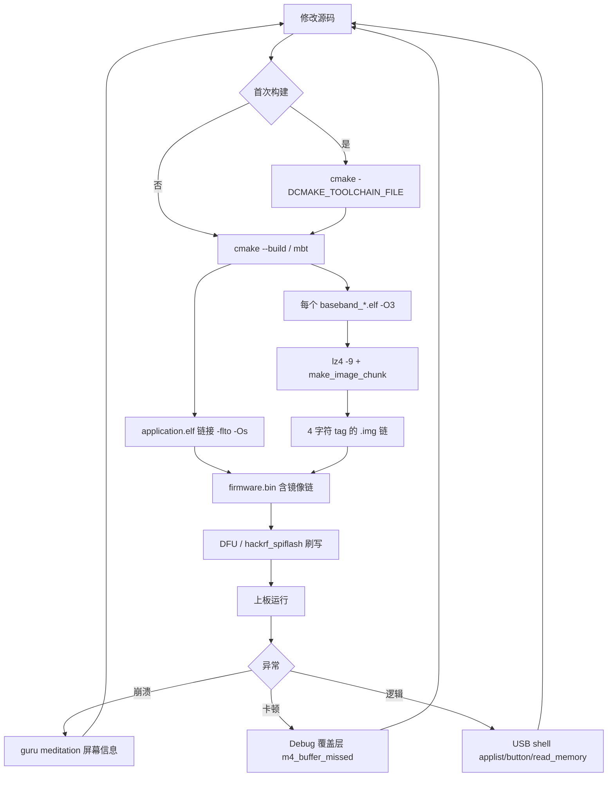
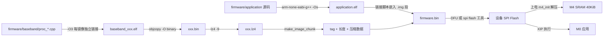

# PortaPack Mayhem 源码详解 07：开发与调试指南

> 涉及文件：
> - `CMakeLists.txt`（根，固件镜像/Flash 分层）
> - `firmware/toolchain-arm-cortex-m.cmake`（交叉工具链）
> - `firmware/application/CMakeLists.txt`（M0 应用构建）
> - `firmware/baseband/CMakeLists.txt`（M4 多镜像构建，`DeclareTargets`）
> - `firmware/application/external/external.cmake`（外部 App 清单）
> - `firmware/application/external/adsbrx/main.cpp`（外部 App 入口模板）
> - `firmware/application/usb_serial_shell.cpp`（串口调试命令）
> - `firmware/application/debug.cpp`（guru meditation / 栈回溯）
> - `firmware/application/ui_navigation.cpp`（`appList` 注册）
> - `dockerize.sh`、`mbt`（构建脚本）
>
> 相关 KB：[app_view.md](../../../05-学习笔记与知识库/Knowledge-Base/mayhem/app_view.md)、[event_dispatcher.md](../../../05-学习笔记与知识库/Knowledge-Base/mayhem/event_dispatcher.md)

---

## 1. 工具链与构建系统

| 组件 | 版本/说明 | 出处 |
|---|---|---|
| 交叉编译器 | `arm-none-eabi-gcc`（CI 用 9-2019-q4-major，`mbt` 会自动下载） | `mbt:4`、`toolchain-arm-cortex-m.cmake:33-36` |
| 构建系统 | CMake ≥ 3.16 + Make/Ninja | 根 `CMakeLists.txt:22` |
| 标准 | C++20（不支持时回退 C++17），`-fno-rtti -fno-exceptions` | `application/CMakeLists.txt:41-47` |
| 优化 | 应用 `-Os`；基带 `-O3` | `application/CMakeLists.txt:35`、`baseband/CMakeLists.txt:361` |
| LTO | 应用的非 external 源码加 `-flto` | `application/CMakeLists.txt:349` |
| FPU | **M0：`USE_FPU no`（软浮点）；M4：`USE_FPU hard`** | `application/CMakeLists.txt:88`、`baseband/CMakeLists.txt:88` |
| 压缩 | 基带镜像 LZ4 `-9` 压缩后打包 | `baseband/CMakeLists.txt:333-337` |

### 1.1 一条命令构建

```bash
# 方式 A：Docker（推荐，环境固定）
./dockerize.sh                 # 构建
./dockerize.sh -j10            # 并行
./dockerize.sh -DBOARD=PRALINE # 换板型

# 方式 B：本机（需自备 arm-none-eabi-gcc）
./mbt                          # 自动下载工具链并 cmake --build
```

`dockerize.sh` 的注释把常用参数写全了（`dockerize.sh:7-30`）：`build`/`shell`/`-jN`/`ninja`/`-B build-alt`。

### 1.2 Flash 分层（`FLASH_TIER`）

根 `CMakeLists.txt:62-70` 根据 Flash 容量决定哪些 App 编进主固件、哪些作为外部 App：

| Flash 限制 | `FLASH_TIER` | 链接脚本 | 含义 |
|---|---|---|---|
| ≤ 1 MB | 0 | `external_tier0.ld` | 几乎所有 App 都是外部 `.ppma` |
| ≤ 2 MB | 1 | `external_tier1.ld` | 部分内置（ADS-B/APRS/AIS 等） |
| > 2 MB | 2 | `external_tier2.ld` | 更多内置（Analog TV/ProtoView 等） |

`ui_navigation.cpp:114-122` 里用 `#if FLASH_TIER >= 1/2` 控制哪些 App 出现在 `appList`。

## 2. 新增一个应用：最小步骤

### 2.1 内置 App（编进主固件）

**Step 1：写 View 子类** `firmware/application/apps/ui_myapp.hpp/.cpp`

> 以下四段是**新增模板代码**（仓库里还不存在，故不标行号），照抄后按需改名。

```cpp
class MyAppView : public View {
   public:
    MyAppView(NavigationView& nav);   // 构造函数签名必须如此
    std::string title() const override { return "MyApp"; }
    void focus() override;
   private:
    NavigationView& nav_;
    Text text{{0, 0, 30 * 8, 16}, "Hello"};
};
```

**Step 2：加入构建清单** `firmware/application/CMakeLists.txt` 的 `CPPSRC`（第 302-332 行那段）：

```cmake
	apps/ui_myapp.cpp
```

**Step 3：注册到 `appList`**（`ui_navigation.cpp:100-151`）：

```cpp
    {"myapp", "My App", UTILITIES, Color::green(), &bitmap_icon_dir, new ViewFactory<MyAppView>()},
```

`id` 必须唯一（串口 `appstart myapp` 与开机自启都靠它）；`menuLocation` 决定出现在
HOME/RX/TX/TRX/UTILITIES 哪个网格。

**Step 4（可选）：需要 M4 基带时**

1. 写 `firmware/baseband/proc_myapp.hpp/.cpp`，继承 `BasebandProcessor`，实现
   `execute(const buffer_c8_t&)` 与 `on_message(const Message*)`，文件末尾提供 `int main()`：

   ```cpp
   int main() {
       EventDispatcher event_dispatcher{std::make_unique<MyProcessor>()};
       event_dispatcher.run();
       return 0;
   }
   ```

2. 在 `baseband/CMakeLists.txt` 里加镜像（仿照 `:363-369` 的 AFSK TX）：

   ```cmake
   set(MODE_CPPSRC
       proc_myapp.cpp
   )
   DeclareTargets(PMYA myapp)
   ```

   `DeclareTargets(chunk_tag, name)` 会：编译 `proc_myapp.cpp`（`-O3`）→ 链接 → `objcopy -O binary`
   → `lz4 -9` → `make_image_chunk` 打包成带 4 字符 tag 的 `.img`（`baseband/CMakeLists.txt:314-345`）。

3. 在 `common/spi_image.hpp:76-147` 加 tag：

   ```cpp
   constexpr image_tag_t image_tag_myapp{'P', 'M', 'Y', 'A'};   // 模板：新增行
   ```

4. App 构造时加载：`baseband::run_image(portapack::spi_flash::image_tag_myapp);`

### 2.2 外部 App（`.ppma`，放 SD 卡）

目录结构：

```
firmware/application/external/myapp/
├── main.cpp           # 入口 + application_information_t
├── ui_myapp.hpp/.cpp  # View 实现
└── tier.txt           # 0/1/2，决定打进哪个 tier 的链接脚本
```

`main.cpp` 的固定套路（`external/adsbrx/main.cpp:26-83`，中间省略图标数组）：

```cpp
namespace ui::external_app::adsbrx {

void initialize_app(ui::NavigationView& nav) {
    nav.push<ADSBRxView>();
}

}  // namespace ui::external_app::adsbrx

extern "C" {

__attribute__((section(".external_app.app_adsbrx.application_information"), used)) application_information_t _application_information_adsbrx = {
    /*.memory_location = */ (uint8_t*)0x00000000,
    /*.externalAppEntry = */ ui::external_app::adsbrx::initialize_app,
    /*.header_version = */ CURRENT_HEADER_VERSION,
    /*.app_version = */ VERSION_MD5,

    /*.app_name = */ "ADS-B",
    /*.bitmap_data = */ {
```

`bitmap_data` 是 32 字节（16×16 图标，1 bit/像素），原文占 `external/adsbrx/main.cpp:44-75`，
`76` 行是数组的 `},`。数组之后：

```cpp
    /*.icon_color = */ ui::Color::green().v,
    /*.menu_location = */ app_location_t::RX,
    /*.desired_menu_position = */ -1,

    /*.m4_app_tag = portapack::spi_flash::image_tag_adsb_rx */ {'P', 'A', 'D', 'R'},
    /*.m4_app_offset = */ 0x00000000,
};
```

`application_information_t` 的定义在 `common/external_app.hpp:30-48`，`CURRENT_HEADER_VERSION = 3`。
**`.m4_app_tag` 必须与它要用的基带镜像 tag 一致**；没有基带就填 `{0,0,0,0}`。

最后把 `external/myapp/main.cpp` 与 `ui_myapp.cpp` 加入 `external/external.cmake` 的 `EXTCPPSRC`。

## 3. 调试手段

### 3.1 崩溃现场：guru meditation

M4 崩溃时把 panic 字符串写进 `shared_memory.m4_panic_msg`，M0 在每轮 `dispatch()`
最开头检查（`event_m0.cpp:335-344`），调用 `draw_guru_meditation()` 画寄存器与栈回溯
（`debug.cpp:92-130`）。M0 自己崩溃则走 HardFault 处理（`debug.cpp:326-381`）。

屏幕上的信息包括：故障源（M0/M4）、hint 字符串、R0-R12/PC/LR/xPSR、CFSR、栈 dump。
**看到它先拍照**，因为重启后信息就没了。

### 3.2 运行时观测：性能计数与丢缓冲

| 量 | 位置 | 读法 |
|---|---|---|
| M4 缓冲丢失数 | `shared_memory.m4_buffer_missed` | Debug 覆盖层（按 Dfu 键一次） |
| M4 最大样本幅度 | `m4_performance_counter`（模式 2） | 同上 |
| M4 栈/堆用量 | `m4_stack_usage` / `m4_heap_usage` | 同上 |
| 抓取丢字节 | `CaptureConfig::baseband_bytes_dropped` | 录制界面百分比 |

`baseband_thread.cpp:105-117` 在 `request_m4_performance_counter == 0x02` 时逐样本统计峰值，
这是唯一"侵入式"的观测代码，会拖慢实时处理，只用于短时诊断。

### 3.3 USB 串口 shell

固件通过 USB CDC 暴露一个 shell（`usb_serial_shell.cpp:1517-1557`），常用命令：

| 命令 | 作用 |
|---|---|
| `applist` / `appstart <id>` | 列出/按 id 启动 App（`id` 就是 `appList` 的短名） |
| `screenshot` / `screenframe` | 截屏（PNG/PPM）到 SD |
| `button <key>` / `touch x y` / `keyboard <text>` | 注入输入事件（自动化测试） |
| `read_memory` / `write_memory` | 读写内存（调试外设寄存器） |
| `cpld_info` / `cpld_read` / `cpld_write` | CPLD 调试 |
| `sysinfo` / `radioinfo` | 版本/射频状态 |
| `pmemreset` / `settingsreset` | 复位持久化设置 |
| `reboot` / `dfu` / `flash` | 重启/进 DFU/刷写 |
| `sd_over_usb` | 把 SD 卡暴露成 USB 大容量设备 |

shell 线程栈 **3 KiB**（`SHELL_WA_SIZE = THD_WA_SIZE(1024 * 3)`，`usb_serial_shell.cpp:59`），
优先级 `NORMALPRIO + 10`。

### 3.4 输入注入与自动化

`EventDispatcher::emulateTouch()` / `emulateKeyboard()`（`event_m0.cpp:474-488`）用
"设置指针 + 自旋等消费"的方式从**其它线程**注入事件，配合 shell 的 `button`/`touch` 命令
可以在没有手指的情况下跑 UI 流程。注意它们会 `chThdSleepMilliseconds(5)` 轮询，
只适合测试，不适合生产路径。

## 4. 性能陷阱清单

| 陷阱 | 量化 | 规避 |
|---|---|---|
| 消息队列满 | 每队列 2048 B，消息上限 512 B → 最多 4 条满消息 | 高频消息用小结构体；不要每帧发大包 |
| `send_message()` 自旋 | 等 M4 取走，最长 3 s 后 `chDbgPanic` | 不要在一个事件处理里连发几十条配置 |
| 基带线程栈 | 4096 B（`baseband_thread.cpp:42`） | `execute()` 里不要放大数组/递归 |
| 抓取线程栈 | 1024 B（`capture_thread.cpp:50`） | FATFS 调用已接近上限，别再加深调用 |
| 整屏重绘 | 76 800 px × 2 B = 150 KiB | 只 dirty 最小控件 |
| 缩放字体 | 每像素一次 `fill_rectangle` | 大字号静态文本用预渲染位图 |
| M0 浮点 | `USE_FPU no`，软浮点，一次 `float` 乘加几十周期 | UI 代码用整数/定点；DSP 放 M4（硬浮点） |
| 长文件名 | `_USE_LFN=3` 全局静态缓冲 | 避免多线程同时操作长文件名 |
| 20 MSa/s 抓取 | 缓冲周期 204.8 µs，预算 40 960 周期 | 降采样率或接受丢样本 |
| `paint()` 里做 I/O | 每帧调用 | 数据更新用消息 + `set_dirty()` |

### 4.1 一个真实的性能计算

抓取 5 MSa/s、`.C8` 格式：写入速率 = 5 M × 2 B = **10 MB/s**。
SD 卡 Class 10 的**持续写**上限约 10 MB/s，减去 FAT 元数据与擦除抖动，实际有效约 6–8 MB/s。
若 FIFO 只有 8 KB（4 块 × 2 KB），SD 卡一次 30 ms 的写停顿就会丢
`10 MB/s × 30 ms = 300 KB` 数据。这就是 `CaptureConfig` 让 App 传 `buffer_count` 的原因——
**FIFO 深度必须覆盖 SD 卡的最坏写延迟**。

## 5. 构建与调试闭环



## 6. 数据流图：从源码到设备



## 7. 陷阱与实测建议

- **不要用 `-O0` 调基带**：`execute()` 的时间预算按 `-O3` 算，`-O0` 下 20 MSa/s 必丢样本。
  要调试就用日志/计数，不要降优化级别跑实时链路。
- **M0 没有 FPU**：`application/CMakeLists.txt:88` 明确 `USE_FPU no`。
  在 UI 代码里写 `float` 会链接软浮点库，一次除法可能上百周期。UI 里的频率/电压计算尽量用整数。
- **新增基带镜像要同步三处**：`baseband/CMakeLists.txt` 的 `DeclareTargets`、
  `common/spi_image.hpp` 的 tag、App 里的 `run_image()`。漏一处就会"消息发出去没人收"。
- **`DeclareTargets` 的 chunk_tag 是 4 字符**，且必须与 `image_tag_t` 完全一致
  （`{P,M,Y,A}` ↔ `"PMYA"`）。tag 冲突会让 `m4_init()` 加载错镜像。
- **外部 App 的 `tier.txt`** 决定它进哪个链接脚本；写错会导致低容量机器上链接失败或 App 消失。
- **`appstart` 依赖 `id` 唯一**：两个 App 用同一个 id，`StartAppByName` 只会命中第一个
  （`ui_navigation.cpp:153-163`）。
- **shell 的 `screenshot` 需要 SD 卡**且会阻塞 UI 几十毫秒；自动化测试里要留足等待时间。
- **guru meditation 会一直重绘**：`dispatch()` 每轮都检查 `m4_panic_msg`，只要不清零就一直画，
  UI 实际上已经"停摆"，只能重启。
- **刷机前确认板型**：`BOARD=PRALINE` 与默认 HackRF One 的镜像不通用（内存映射、FPGA、调谐表全不同）；
  刷错会直接不启动（`memory_map.hpp:68-70` 有编译期 `#error` 保护源码，但保护不了刷错的二进制）。
